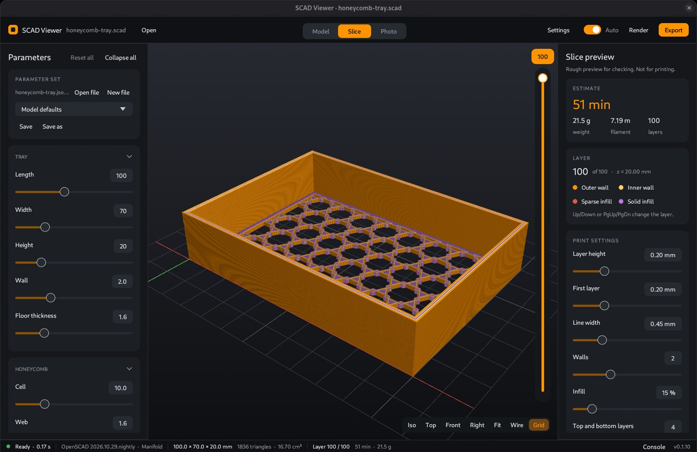
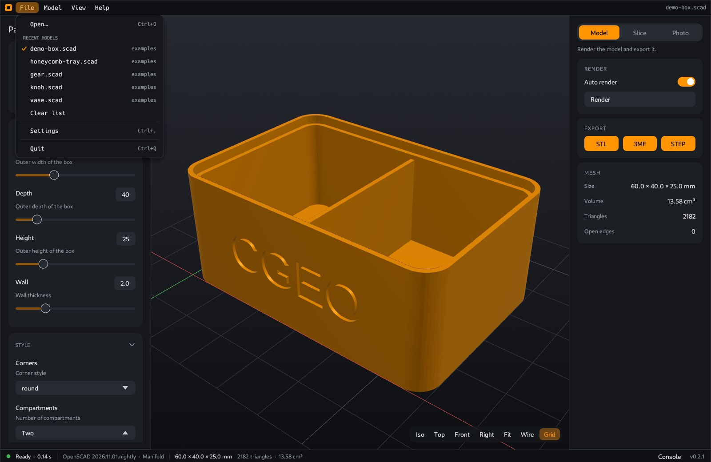
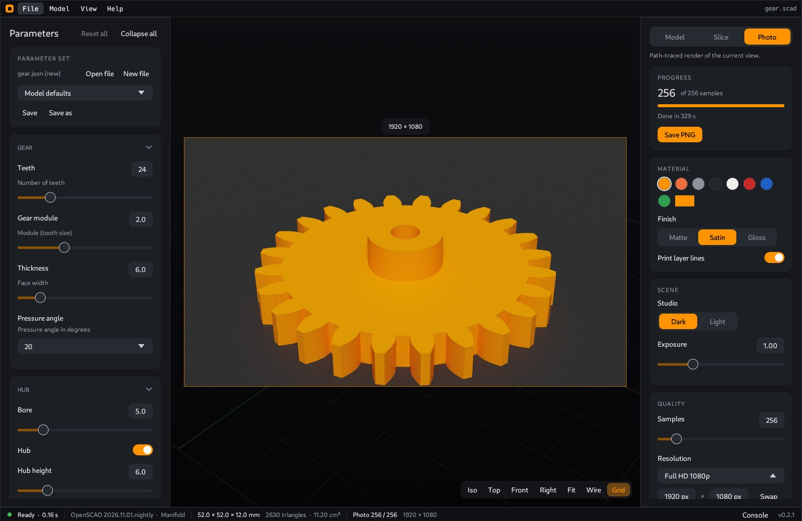
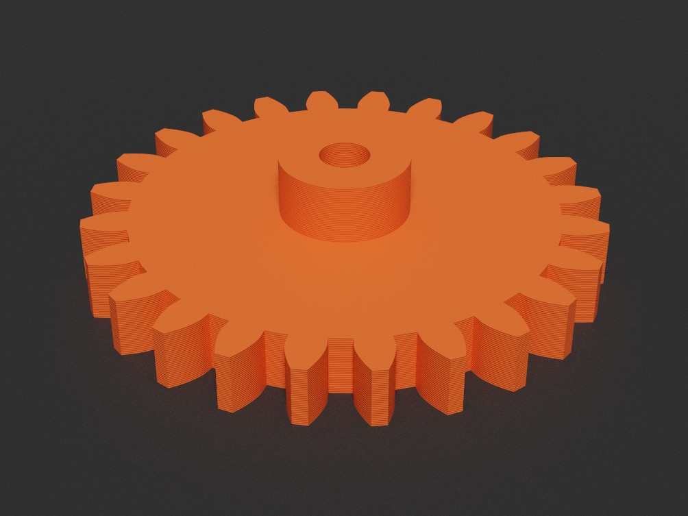
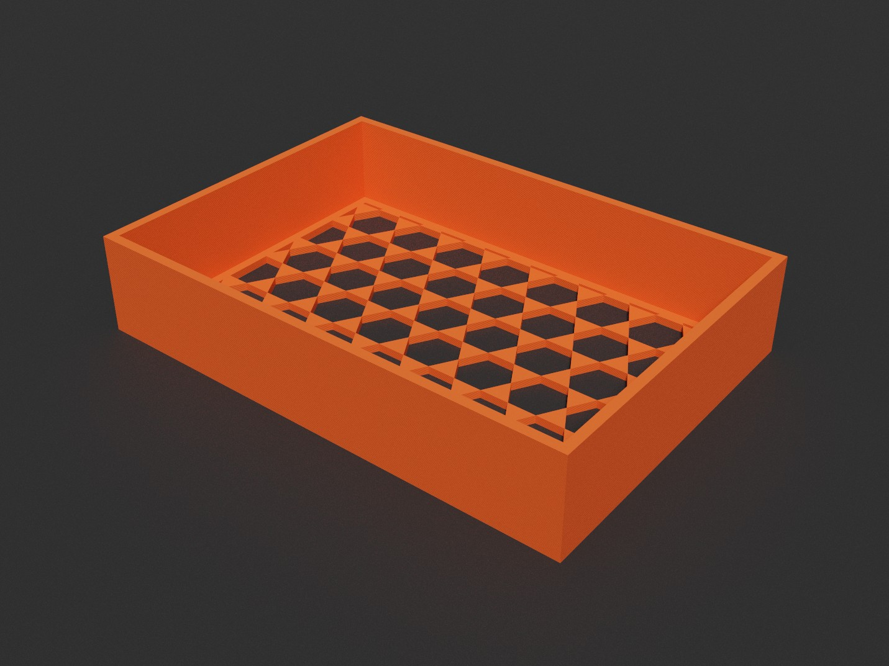
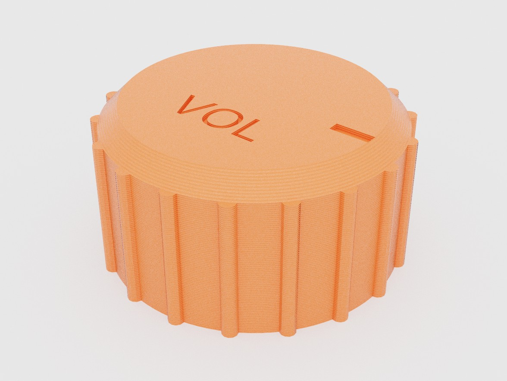
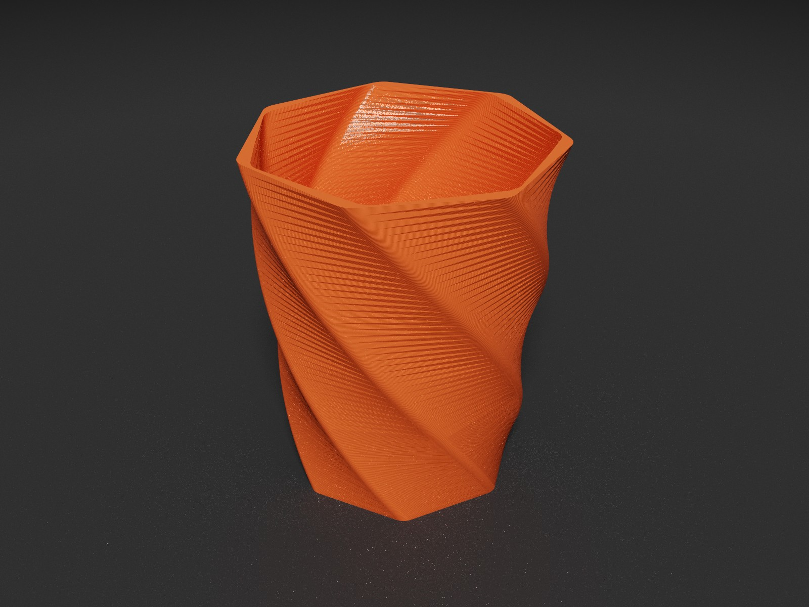

# CoCAD

[](https://github.com/cgeosoft/cocad/actions/workflows/build.yml)
[](LICENSE)


A fast desktop viewer for OpenSCAD models. Open a `.scad` file, change its Customizer parameters with sliders, and see the model update. Export STL, 3MF or STEP, check the print layers, and render a photo of the part.



OpenSCAD does the geometry. CoCAD runs the `openscad` CLI in the background, reads the mesh and does the rest. With an OpenSCAD development build (Manifold backend), most models render in less than a second.

## Highlights

- **Customizer panel.** Sliders, dropdowns, switches, text and vectors, in collapsible groups. The model renders again when you change a value.
- **Parameter sets.** Save and load named sets in any `.json` file. OpenSCAD reads the same format.
- **Export.** Binary STL, 3MF with the parameters in the metadata, and STEP AP214 with real planar faces.
- **Slice preview.** Walls, infill and top and bottom skin as round strands, with a layer slider and a time, length and weight estimate.
- **Photo render.** A path tracer makes a studio photo of the current view, in a plastic color and finish you choose.
- **Parts.** The 3D view finds the separate solids of the model. **Part colors** shows each part in its own color, in the view and in the photo.
- **Multicolor 3MF.** A model can list parts with a `cocad_part` parameter. The 3D view shows each part in its color. CoCAD renders each part and writes a 3MF for PrusaSlicer 2.9 or OrcaSlicer, with one filament for each part.
- **Examples.** **File > Examples** opens a sample model. The app writes the models to `examples/` in its settings folder. Your edits to these copies stay.
- **Mesh check.** Size, volume, triangles and open edges. Back faces show in purple.
- **CLI.** Batch export, slice and photo without the window.
- **MCP server.** Claude Desktop and other MCP clients can read the model, change parameters, render and export in the open window.
- **Privacy choices.** Usage analytics and error reports are optional. Each stays off until you accept it.
- Linux, Windows and macOS. Dark and light themes.

## Install

1. Install OpenSCAD. A development snapshot is much faster than the 2021 release: <https://openscad.org/downloads.html#snapshots>.
2. Download CoCAD for your system from the [releases page](https://github.com/cgeosoft/cocad/releases):

| System | File | How to install |
|---|---|---|
| Debian, Ubuntu | `cocad_<version>_amd64.deb` | `sudo apt install ./cocad_<version>_amd64.deb` |
| Other Linux | `cocad-<version>-linux-x86_64.tar.gz` | Unpack and run `cocad`. Needs GTK 3 and OpenGL. |
| Windows | `cocad-<version>-windows-x86_64.zip` | Unpack and run `cocad.exe`. |
| macOS (Apple Silicon and Intel) | `cocad-<version>-macos-universal.zip` | Unpack and move **CoCAD** to Applications. The app is not signed: the first time, right-click it and choose **Open**. |

CoCAD finds OpenSCAD on the `PATH` and in the usual install folders (`C:\Program Files\OpenSCAD*`, `/Applications/OpenSCAD*.app`, Homebrew). If it does not, set the binary in **File > Settings**.

## Usage

```bash
cocad model.scad            # open in the model view
cocad --slice model.scad    # open in the slice view
cocad --photo model.scad    # open in the photo view
```

You can also open a file with Ctrl+O or drop it on the window. **File** lists the last 10 models. The window shows the same list when no model is open. When the `.scad` file changes on disk, the model reloads and your edited values stay.

| Input | Action |
|---|---|
| Left drag | Orbit |
| Right or middle drag, Shift + left drag | Pan |
| Wheel | Zoom |
| Click | Select a part. On the background: clear the selection |
| Right click on a part | Part menu: **Focus**, **Change color…** |
| Esc | Clear the selection and leave the focus |
| Double click, `F` | Fit the model, or the part in focus |
| `F5` | Render now |
| `W` | Wireframe |
| `E` | Explode the parts |
| `S` | Model or slice view |
| `P` | Photo view |
| Up / Down, PgUp / PgDn | Change the slice layer |
| Ctrl+O | Open a file |
| Ctrl+, | Settings |
| Ctrl+Q | Quit |
| Alt+F, Alt+M, Alt+V, Alt+H | Open the File, Model, View or Help menu |



The menu bar holds all commands: **File**, **Model**, **View** and **Help**. The right sidebar has the **Model**, **Slice** and **Photo** tabs. The **Model** tab has Auto render, Render, the export buttons, the parts, the explode, the section and the mesh data.

At the first start, a welcome tour shows the main features one step at a time, with the MCP setup. To see it again, use **Help > Welcome tour**. Keys: Left and Right change the step, Enter goes on, Esc closes.

The status bar at the bottom shows the render state and time, the OpenSCAD version and backend, the model size, triangles and volume, open edges, the slice or photo state, and the **Console** button with the OpenSCAD output.

## MCP server

CoCAD has an MCP server, so that an AI client can work with the open window. The client can read the model and its parameters, change values, see the result as an image, and run app commands.

Add the server to the client. For Claude Desktop, edit `claude_desktop_config.json` and restart Claude Desktop:

```json
{
  "mcpServers": {
    "cocad": {
      "command": "cocad",
      "args": ["mcp"]
    }
  }
}
```

Use the full path of the binary when it is not on the `PATH` of the client. On Windows, this is `cocad.exe` in the folder where you unpacked the zip, with double backslashes in the JSON. On macOS, it is `CoCAD.app/Contents/MacOS/cocad` in Applications.

The client starts `cocad mcp`. This process has no window. It sends each tool call to the open window, and you see the changes there. `open_model` starts the app when it is not running.

| Tool | Action |
|---|---|
| `get_state` | Loaded file, render status, last error, mesh data, changed parameters, parameter sets, parts, part colors, explode, section cut, end of the OpenSCAD log |
| `get_params` | All Customizer parameters with type, value, default, limits and options |
| `get_source` | Source of the `.scad` file |
| `view_model` | Render an image and return it to the client |
| `open_model` | Open a `.scad` file |
| `set_params`, `reset_params` | Change parameters or reset them, then render |
| `render` | Run OpenSCAD again |
| `load_parameter_set`, `save_parameter_set` | Load or save a parameter set |
| `export_model` | Write STL, 3MF or STEP. With `slicer`, write a multicolor 3MF |
| `save_photo` | Write a path traced PNG |
| `slice` | Slice and return layers, filament, weight and a rough print time |
| `set_view` | Change the tab, camera direction, wireframe, grid, part colors, explode, section cut and slice layer |
| `list_windows`, `select_window` | Choose a window when more than one is open |

Behavior:

- `set_params` uses the limits of the Customizer panel. One bad value rejects the whole call.
- Calls wait for the render, for at most 45 seconds. Then they return the state with status `rendering`, or an error.
- `export_model` and `save_photo` do not replace a file without `overwrite`. They and `view_model` fail when the last render failed, so that they do not use an old mesh.
- `view_model` and `save_photo` put the whole model in the frame. They use the camera direction of the window, or the given `view`.
- `view_model` and `save_photo` show the part colors, the explode and the section cut of the window, as the **Photo** tab does. When the part colors or the explode are on and CoCAD still finds the parts, they wait for the parts, for at most 45 seconds.
- `set_view`: `explode` sets the explode distance in mm, and 0 turns the explode off. A distance above the end of the slider uses the end of the slider. `explode_axis` sets the direction (`all`, `x`, `y` or `z`) and turns the explode on.
- `set_view`: `section` sets the section cut, for example `{"x": {"at": 12.5, "keep": "+"}}`. The object replaces all cuts. An axis that is missing or `null` has no cut, and `{}` turns all cuts off. `at` is the position in mm. The default is the center of the model. A position out of the slider range uses the end of the range. `keep` is `+` (keep the side above the position) or `-` (keep the side below). The default is `+`. `get_state` shows the cuts in the same form.
- `save_photo` stops after 40 seconds and saves the samples it has.
- `open_model` opens only `.scad` files. `save_photo` writes only `.png` files. `export_model` and `save_photo` do not write through a symbolic link.
- The tools cannot delete a parameter set or a file.
- A minimized window may not answer until you restore it.

Security: each window listens on a free port of `127.0.0.1` and accepts only calls with a random token. The token is in `mcp/<pid>.json` in the settings folder, which only your user can read. Any program that runs as your user can read that file and control the window, and write files through the export tools. The server is on by default. To turn it on or off, use **MCP server** in **File > Settings**. The change applies when you save. Other open windows change at their next start.

## Parameter sets

The **Parameter set** card at the top of the panel holds named sets of values.

- The first line shows the sets file. **Open file** loads sets from any `.json` file. **New file** picks a place and name for a new sets file. It is written on the first save.
- The app remembers the sets file for each model. Without one, it uses `<model>.json` next to `<model>.scad`.
- When the sets file changes on disk, the list of sets updates. The active set takes the new values, unless it has edits.
- Select a set to load it. **Model defaults** sets all values back to the `.scad` defaults.
- **Save** writes the values to the selected set. With no set selected, it asks for a name.
- **Save as** saves the values as a new set. **Delete** removes the selected set (click two times).
- The file uses the OpenSCAD Customizer format. OpenSCAD reads it too: `openscad -p sets.json -P big`.

## Parts in the 3D view

The 3D view divides the model into parts. The **Parts** card in the **Model** and **Photo** tabs shows the number of parts. CoCAD finds the parts in this order:

1. A model with a `cocad_part` list that shows all parts: CoCAD renders each part in the background (see [Multicolor 3MF](#multicolor-3mf)). When the parts are done, they replace the solids, so parts that touch stay separate. Shapes that are in no part become "Other" parts.
2. A model without a `cocad_part` list: the module split. After each render, CoCAD runs OpenSCAD one more time to write the CSG tree of the model. This run makes no geometry. In the tree, each module call is a group. CoCAD finds the highest level with two or more module calls, and one more level below it, for example `assembly() { board(); pieces(); }`. Then it renders each module call on its own, in parallel. Each solid of each module is one part, so parts that touch stay separate. The Parts card shows "Finding the parts…" while this runs.
3. All other models, or a module split that finds no parts: the solids of the mesh.

- A solid is a set of triangles that connect at their edges. A cavity stays with the solid around it. A sliver with almost no volume goes to the nearest part. The solids of one mesh are in volume order, the largest first. The parts are "Part 1", "Part 2" and so on.
- Limits of the module split: a part made of two or more module calls divides into these modules. An explicit `union()` stays one part. A level with more than 64 module calls gives no split. A model with a `cocad_part` list that shows one part keeps the solids of the mesh. Fonts from `use <font.ttf>` in the model file work, but not fonts that only a library loads. When the module split fails, the error goes to the OpenSCAD output and the solids stay.
- **Part colors** shows each part in a different color. A part of the `cocad_part` list keeps its color. The other parts get colors from a palette of 12 colors.
- **Colors…** opens the list of all parts with their volumes. Click a color to change it. **Reset** sets the default color again. A color change turns on **Part colors**. The colors stay when the model renders again. When you open a different model, CoCAD clears them.
- With **Part colors** on, the photo uses the part colors in place of the material color. The finish and the layer lines stay.
- The part colors are for the view and the photo only. The export does not change.

### Select and focus

Click a part in the 3D view to select it. The part shows brighter, with an orange edge. The **Parts** card shows its name, size and volume. A click on the background or Esc clears the selection. A drag turns or moves the view and does not change the selection.

A right click on a part selects it and opens the part menu. A right drag still moves the view. Esc first closes the part menu or the color window.

- **Focus**: the view turns around the center of the part, and the other parts become transparent. When the part is not fully in the view, the camera moves back until the part fits. Then `F`, double click and the view buttons fit this part. A click goes through the transparent parts to the part in focus. A click on a transparent part selects it when the part in focus is not under the mouse.
- **Leave focus** (or Esc) makes all parts opaque again. The center of rotation goes back to the center of the model. The camera direction and distance stay. While a part has the focus, a right click on the background opens a menu with only **Leave focus**.
- **Change color…** opens a color window for the part at the top right of the 3D view. The 3D view shows each change at once. **Reset** sets the default color again. A color change turns on **Part colors**, as in **Colors…**.
- The selection and the focus use the part name. When the model renders again and has a part with that name, they stay. When you open a different model, CoCAD clears them.
- With **Explode** on, a click finds the part at its moved position, and the focus moves with the part.
- The selection and the focus are for the 3D view of the **Model** and **Photo** tabs only. The **Slice** tab and the photo do not show them.

### Explode

The **Explode** card in the **Model** and **Photo** tabs moves the parts away from each other. It needs two or more parts. `E` or **View > Explode** turns it on and off.

- **Distance** sets the movement in mm. The part that is farthest from the center of the model moves this distance. The other parts move less, by the same ratio as their distance from the center. A part at the center does not move.
- **Direction**: **All** moves each part along the line from the center of the model to the center of the part. **X**, **Y** and **Z** move the parts along that axis only.
- When all parts have the same center (for example, concentric parts), the parts make a stack. The largest part does not move. The other parts move up, or along the selected axis, in volume order. The smallest part moves the full distance.
- The slider goes to approximately 2 times the largest size of the model. The default distance is approximately half of the largest size. A new render keeps your distance. When you open a different model, the distance goes back to the default.
- A change of the distance or the direction turns on the explode.
- The camera does not move. Press `F` to fit the exploded model in the view. The grid moves down below the lowest part.
- The explode is for the 3D view and the photo only. The **Slice** tab shows the parts at their real positions, so that the mesh agrees with the tool paths. The export does not change.

### Section

The **Section** card in the **Model** tab cuts the model to show the inside. You can cut across the X, Y and Z axes.

- **Cut X**, **Cut Y** and **Cut Z** turn on a cut across that axis.
- **Position** sets the position of the cut in mm. The slider goes across the model, with a small margin. The default position is the center of the model. When you move the slider or put the pointer on it, a blue rectangle shows the plane of the cut.
- **Keep +X** keeps the side above the position. **Keep −X** keeps the side below the position. Y and Z work the same.
- When two or three cuts are on, only the space that all cuts keep stays. For example, cuts on X and Y keep one quarter of the model.
- The cut faces show in the color of the part, a little darker. A transparent part shows no cut face. A part that is not closed can show no cut face or a wrong cut face. While a cut is on, the inside faces of the parts show in a dark part color, not in purple.
- The cut is in the coordinates of the model. With the explode on, each part moves with its cut.
- **Reset** turns off all cuts and moves them to the center.
- A new render keeps the cuts and their positions. When you open a different model, the positions go back to the center.
- The photo and the MCP images show the cut. The **Slice** tab, the grid, fit and the export do not use it.
- The cut faces need a stencil buffer in the OpenGL driver. Without it, the inside of each part shows in a dark part color.

## Slice preview

The **Slice** view cuts the model into layers and shows the paths a printer would follow: outer and inner walls, sparse infill, and solid top and bottom skin. The strands have the real line width and layer height. Most models slice in less than 50 ms.

Settings: layer height, first layer height, line width, walls, infill, top and bottom layers, and speed. The card on top shows the print time, the filament length and the weight.

The slicer is for preview only. It has no travel moves, supports or bridges, and it does not write G-code.

## Photo render



The **Photo** view path-traces the current camera view on all CPU cores. The image gets cleaner with each sample. When you move the view or change a setting, the render waits until the view rests, then starts again.

| | | | |
|---|---|---|---|
|  |  |  |  |

- **Material**: 8 color swatches or a color picker. Finish: matte, satin or gloss plastic.
- **Print layer lines**: ripples the sides at the slice layer height, so the part looks printed.
- **Parts**: with **Part colors** on, each part has its own color. With **Explode** on, the parts move apart. See [Parts in the 3D view](#parts-in-the-3d-view).
- **Studio**: dark or light backdrop with a soft key light and floor shadows. Exposure adjusts the brightness.
- **Quality**: samples per pixel (16 to 2048) and the image size. Presets: 720p, 1080p, 1440p, 4K, site preview 4:3 (1600 × 1200), square, portrait 4:5 and story 9:16. You can also type the width and height. **Swap** turns landscape into portrait.
- The view dims everything outside the image frame, so you see what the render will show.
- **Save PNG** writes the image at its full size and the current sample count.

## Export

| Format | Content |
|---|---|
| STL | Binary STL. |
| 3MF | Mesh, with the parameter values in the metadata. |
| STEP | AP214. Coplanar triangles become planar faces. A closed mesh becomes one `FACETED_BREP` solid that CAD tools can edit. |

### Multicolor 3MF

List the parts in a `cocad_part` parameter. Show each part only when it is selected:

```openscad
cocad_part = "all"; // [all, plate, star]

module part(name, col) {
    if (cocad_part == "all" || cocad_part == name) {
        echo(cocad_color = col);
        color(col) children();
    }
}
```

- CoCAD renders each part in a separate OpenSCAD run. A model with N parts takes N renders.
- The 3D view shows each part in its color. When `cocad_part` is `all`, CoCAD renders the parts in the background after the main render. Until they are done, the view shows the solids of the model in orange. Shapes that are in no part, for example hardware previews, are orange. With **Part colors** on, these shapes get palette colors.
- The list order sets the filament number. `echo(cocad_color = ...)` sets the color: a `#RRGGBB` value or a common color name.
- `import()` ignores SVG fill colors. Use one SVG file for each color. See `examples/multicolor-badge.scad`.
- Parts must not overlap. Cut a pocket in one part for the other part.
- With a model that has parts, the Model tab and the **File** menu show one export for each slicer. On the command line, use `--for prusa` or `--for orca`.

The two slicers read different part data, so one file does not work in both. Tests used PrusaSlicer 2.9.7 and OrcaSlicer 2.4.2.

- **PrusaSlicer 2.9**: each part gets its extruder. The file holds no colors. Use a multi-material printer profile. A profile with one filament shows all parts in one color.
- **OrcaSlicer**: each part gets its filament, and the file holds the colors. The printer and process settings stay as they are.
- **PrusaSlicer 3.0 alpha** is not supported. It loads the PrusaSlicer file as one volume.

## Command line

```bash
cocad params model.scad
cocad export model.scad -o model.3mf -D width=80 -D 'shape="square"'
cocad export model.scad -o big.stl -P big          # saved set 'big' from model.json
cocad export badge.scad -o badge.3mf --for orca     # multicolor 3MF for OrcaSlicer
cocad slice model.scad --layer-height 0.2 --infill 20 --walls 3
cocad photo model.scad -o model.png --size 1600x1200 --samples 256 --color eb6f40 --finish satin --layer-lines
```

- `-P name` loads a saved set. `-p file.json` picks the sets file. Without `-p`, the CLI uses the file the app remembers, else `<model>.json`.
- `-D name=value` values apply after the set.
- `photo` renders the iso view to a PNG.

## OpenSCAD engine

OpenSCAD 2021.01 (the Debian package) uses the CGAL backend. CGAL is slow on large models: a model that takes 13 s with CGAL can take 0.3 s with Manifold. OpenSCAD development builds have the Manifold backend.

- With no binary set, CoCAD looks for `openscad-nightly`, then `openscad`, on the PATH and in the usual install folders.
- Open **File > Settings** to set the OpenSCAD binary (for example a development AppImage), extra arguments and the theme.
- When the binary supports Manifold, CoCAD adds `--backend=manifold`. Turn this off in Settings, or set your own `--backend` argument.
- `$OPENSCAD` and `$OPENSCAD_ARGS` override the saved values.

The settings are saved in the settings folder. The CLI commands use them too.

The settings folder also holds `recent`, the list of recent models, `mcp/`, the addresses of the open windows, and `tour_seen`, the marker of the welcome tour. Delete `tour_seen` to show the tour at the next start.

| System | Settings folder |
|---|---|
| Linux | `~/.config/cocad` |
| Windows | `%APPDATA%\cocad` |
| macOS | `~/Library/Application Support/cocad` |

## Customizer syntax

CoCAD reads the same comments as the OpenSCAD Customizer. Parsing stops at the first top-level `module` or `function`.

```openscad
/* [Size] */
// Outer width
width = 40;            // [10:100]
wall = 1.2;            // [0.8:0.2:4]
shape = "round";       // [round, square]
count = 2;             // [1:One, 2:Two]
lid = true;
offset = [0, 0];       // [-20:20]
label = "Hi";          // [10]
/* [Hidden] */
$fn = 64;
```

## Updates

When the window opens and once a day after that, CoCAD asks GitHub for the list of releases. If a newer version exists, a small notice shows at the bottom right.

- Click the notice to see the changes. For a latest version of 0.4.5, the list shows 0.4.0 to 0.4.5, plus all versions between your version and 0.4.0.
- The button in that window opens the download section of the website. CoCAD does not download or install anything.
- Click × to hide the notice until a newer version comes.
- To stop the check, turn off "Check for new versions" in File > Settings > Updates.

The release workflow writes the notes from the commit subjects since the last tag. It leaves out `Version` and `Website:` commits. Each `*` line in the notes is one bullet in the app.

## Privacy

At the first start, CoCAD asks about two optional kinds of data. Both boxes start clear, and you can change them in File > Settings. A change applies at once. CoCAD asks again if the data, the purpose or the recipient changes.

| Choice | Why | What CoCAD sends |
|---|---|---|
| Usage analytics | To see which features people use | App start, view changes, model open with the number of parameters, export format, photo save with the sample count, version, system, processor type, notice version, a random install ID |
| Error reports | To find and repair failures | Error type, a fixed failure code, location in our own source code, version, release channel, system, processor type, notice version, a new random ID for each report |

An error report holds no install ID and no error message. CoCAD does not send model contents, file names, parameter values or OpenSCAD output.

PostHog receives this data. It sees your IP address and does not store it. The app window sends the data. The `params`, `export`, `slice` and `photo` commands and the `cocad mcp` process send nothing.

If you connect an MCP client and usage analytics are on, the window sends only these events for the actions of that client:

- App start, when `open_model` starts the window.
- Model open, for each `open_model` call.
- View change, when `set_view` changes the `mode`.

The other MCP tools, such as `export_model` and `save_photo`, send no event. If error reports are on, the window reports a failure during an MCP action in the same way as other failures.

The update check is separate from these two choices. It sends no analytics. GitHub sees your IP address and the app version. See [Updates](#updates).

File > Settings shows the install ID, with Copy and Reset. A request to delete your analytics data needs this ID. See the [Privacy Notice](https://cocad.cgeosoft.com/privacy/).

A build reads the PostHog project key from `POSTHOG_API_KEY` at compile time. A debug build or a build with no key sends nothing and does not ask. CI uses the `POSTHOG_API_KEY` repository secret for tag builds only. `scripts/build.sh` also reads it from `extras/website/.env` for a release build. The plan for this code is in [docs/telemetry-consent.md](docs/telemetry-consent.md).

## Build

Requirements: Rust (stable, 1.85 or later) and OpenSCAD.

- Debian and Ubuntu also need the GTK 3 and OpenGL development files:

```bash
sudo apt install libgtk-3-dev libxkbcommon-dev libgl-dev
```

- Windows needs the Visual Studio C++ build tools. macOS needs the Xcode command line tools.

Build and run:

```bash
cargo run --release -- examples/demo-box.scad
```

On Linux, the scripts build and test in one step:

```bash
scripts/build.sh            # release build, runs the tests first
scripts/build.sh --debug    # debug build
scripts/package-deb.sh      # writes dist/cocad_<version>_<arch>.deb
```

The `.deb` installs the binary, a desktop entry, an icon, the `.scad` MIME type and the examples.

### Continuous integration

GitHub Actions (`.github/workflows/build.yml`) builds and tests on a version tag, or when you start it by hand:

- Linux: clippy, unit tests, all test models, a `.deb` and a `.tar.gz`.
- Windows: unit tests and a `.zip` (`scripts/package-windows.ps1`).
- macOS: unit tests and a universal `.app` in a `.zip` (`scripts/package-macos.sh`).

A tag `v*` (for example `v0.2.0`) also makes a GitHub release with all files attached. A push to `main` starts no build.

### Source layout

| Path | Content |
|---|---|
| `src/main.rs` | CLI and window start |
| `src/app.rs` | egui application: panels, camera, jobs |
| `src/app/remote.rs` | MCP tools inside the window |
| `src/app/select.rs` | Select a part in the 3D view, part menu, focus, color window of one part |
| `src/app/tour.rs` | Welcome tour |
| `src/mcp.rs` | MCP server, tool list, window listener |
| `src/app/view3d.rs` | 3D view options for the parts: part colors, explode, Parts and Explode cards, part colors window |
| `src/app/section.rs` | Section cut: planes on X, Y and Z, Section card, MCP section state |
| `src/render.rs` | OpenGL shaders and buffers. Draws each part with its own color, offset and transparency, and the section cut with stencil cut faces |
| `src/assembly.rs` | Parts of the 3D view: shells, named parts, part palette, moved mesh for the photo |
| `src/csg_split.rs` | Module split: finds the module calls in the CSG tree and renders each one |
| `src/ui.rs` | Dark and light palettes and widgets |
| `src/params.rs` | Customizer parameter parser |
| `src/presets.rs` | Parameter sets (OpenSCAD `.json` format) |
| `src/recent.rs` | List of recent models |
| `src/examples.rs` | Example models in the File menu |
| `src/telemetry.rs` | Optional analytics and error reports (PostHog), final allowlist |
| `src/telemetry/consent.rs` | Consent record and migration |
| `src/telemetry/report.rs` | Error report fields, safe stack frames, rate limit |
| `src/update.rs` | Update check on GitHub, list of changes, dismissed version |
| `src/net.rs` | HTTP client setup |
| `src/openscad.rs` | Runs `openscad` and reads the STL |
| `src/mesh.rs` | Indexed mesh, STL reader, checks |
| `src/parts.rs` | Finds the parts of a multicolor model and renders each one |
| `src/export.rs` | STL, 3MF, multicolor 3MF and STEP writers |
| `src/slicer.rs` | Preview slicer |
| `src/pathtrace.rs` | Path tracer for photo renders (BVH, plastic material, studio light, section cut) |
| `examples/` | Test models. The binary embeds the models that render. |
| `scripts/` | Build and packaging scripts |
| `packaging/` | Desktop entry, icon, MIME type for the `.deb` |
| `images/` | README images |

Stack: Rust 2024, `eframe`/`egui` 0.31 with the `glow` (OpenGL 3.3) backend and an own renderer in an egui paint callback. `glam` for math, `zip` for 3MF, `rfd` for file dialogs.

## Tests

- `cargo test`: parser, mesh, STL round trip, STEP faces, 3MF zip, parameter sets, slicer skin, path tracer BVH, parts of the 3D view.
- `scripts/test-models.sh`: renders every model in `examples/`, exports STL, 3MF and STEP, and slices it. Use `--release` for speed, or give model files to test only those.
- The STEP export of `examples/demo-box.scad` loads in OpenCASCADE as one valid solid. Its volume is the same as the STL volume.

| Model | Tests |
|---|---|
| `demo-box.scad` | Every Customizer widget type, text, hull |
| `gear.scad` | Involute teeth from polygon math, many facets |
| `knob.scad` | rotate_extrude, ribs, D-shaft bore, text |
| `vase.scad` | linear_extrude with twist and scale, sloped walls, 450 layers |
| `bracket.scad` | Holes, slots, a gusset, overhangs |
| `honeycomb-tray.scad` | Many holes per layer, thin webs, `include <lib/hex.scad>` |
| `multicolor-badge.scad` | SVG inlays, one part for each color in touching solids |
| `open-mesh.scad` | Open mesh: open-edge warning, STEP as an open shell |
| `flat-2d.scad` | 2D only: must fail with a clear error |
| `empty.scad` | No geometry: must fail with a clear error |

Models with `// expect: error` on the first line must fail.

## License

MIT. See [LICENSE](LICENSE).
