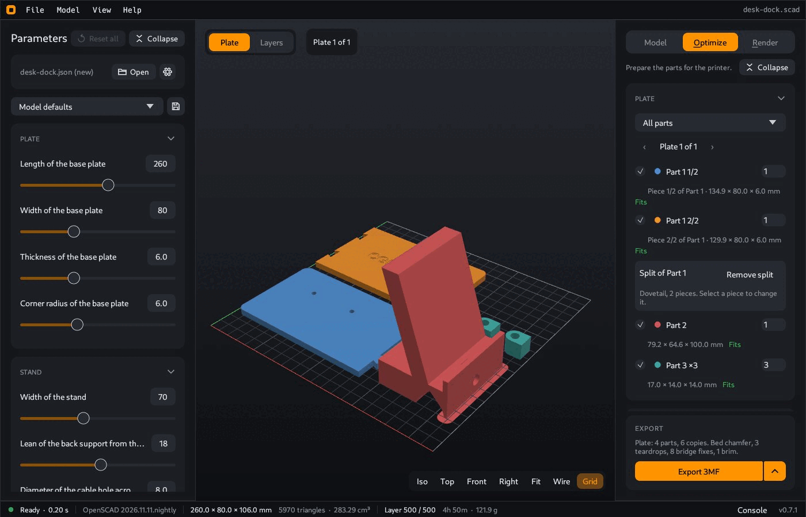

# CoCAD

[](https://github.com/cgeosoft/cocad/actions/workflows/build.yml)
[](LICENSE)


A fast desktop viewer for OpenSCAD models. Open a `.scad` file, change its Customizer parameters with sliders, and see the model update. Prepare the parts for your 3D printer, check the print layers, export STL, 3MF or STEP, and render a photo of the part.



OpenSCAD does the geometry. CoCAD runs the `openscad` CLI in the background (the build), reads the mesh and does the rest. CoCAD needs an OpenSCAD development snapshot with the Manifold backend.

The model file needs only the assembled model. The **Optimize** tab does the print preparation: it puts the parts on the bed, turns them, adds teardrop holes, hole size and bridge fixes, a bed chamfer, brims and mouse ears, and splits parts that are too large. Open **File > Examples > Desk dock** and follow the guide [Prepare a model for printing](https://github.com/cgeosoft/cocad/wiki/Prepare-a-model-for-printing).

**The full documentation is in the [wiki](https://github.com/cgeosoft/cocad/wiki).**

## Features

| Feature | Wiki page |
|---|---|
| Sliders, lists and switches for the Customizer parameters | [Change the parameters](https://github.com/cgeosoft/cocad/wiki/Parameters) |
| Named sets of values in a `.yml` file next to the model, with the title and the part names | [Parameter sets](https://github.com/cgeosoft/cocad/wiki/Parameter-sets) |
| Part colors, select, focus, explode, section cut, and `%` reference parts that are not printed | [Parts](https://github.com/cgeosoft/cocad/wiki/Parts) |
| A print plate for your printer: same parts with copies, custom orientation, print fixes, a print check and a split with flat, pin or dovetail joints | [Optimize](https://github.com/cgeosoft/cocad/wiki/Optimize) |
| Print layers of the plate with a time, length and weight estimate | [Optimize](https://github.com/cgeosoft/cocad/wiki/Optimize#layers) |
| STL and 3MF of the print plate, STEP of the model, with a mesh check | [Export](https://github.com/cgeosoft/cocad/wiki/Export) |
| Multicolor 3MF for PrusaSlicer 2.9 and OrcaSlicer | [Multicolor prints](https://github.com/cgeosoft/cocad/wiki/Multicolor-prints) |
| Path traced studio photo of the part | [Render](https://github.com/cgeosoft/cocad/wiki/Render) |
| MCP server for Claude Desktop and other AI clients | [AI assistant](https://github.com/cgeosoft/cocad/wiki/AI-assistant), [MCP reference](https://github.com/cgeosoft/cocad/wiki/MCP-reference) |
| Batch export, slice and photo without the window, with the print options | [Command line](https://github.com/cgeosoft/cocad/wiki/Command-line) |

Linux, Windows and macOS. Dark and light themes.

## Install

1. Install an OpenSCAD development snapshot (nightly build): <https://openscad.org/downloads.html#snapshots>. CoCAD needs its Manifold backend. The release 2021.01 does not work. At the start, CoCAD shows the install steps when it finds no snapshot.
2. Download CoCAD for your system from the [releases page](https://github.com/cgeosoft/cocad/releases).

The steps for each system are on the [Install](https://github.com/cgeosoft/cocad/wiki/Install) page.

## Use

```bash
cocad model.scad
```

You can also press Ctrl+O, drop a file on the window, or open a sample model with **File > Examples**. At the first start, a welcome tour shows the main features. See [First steps](https://github.com/cgeosoft/cocad/wiki/First-steps).

## Privacy

Usage analytics and error reports are optional. Each stays off until you accept it. CoCAD does not send model contents, file names, parameter values or OpenSCAD output. The update check asks GitHub for the list of releases, and you can turn it off. See [Privacy](https://github.com/cgeosoft/cocad/wiki/Privacy) and the [Privacy Notice](https://cocad.cgeosoft.com/privacy/).

## Build

Requirements: Rust (stable, 1.85 or later) and an OpenSCAD development snapshot.

```bash
cargo run --release -- examples/demo-box.scad
```

For the system packages, the scripts, the tests, CI and the source layout, see [Build from source](https://github.com/cgeosoft/cocad/wiki/Build-from-source).

## Documentation source

The wiki pages are the files in [`docs/wiki/`](docs/wiki). Edit them there. `scripts/publish-wiki.sh` copies them to the GitHub wiki.

## License

MIT. See [LICENSE](LICENSE).
