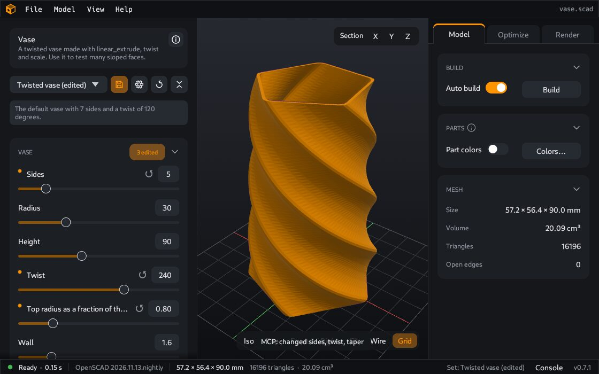

# AI assistant

You can let an AI assistant, for example Claude, work with the open CoCAD window. You tell the assistant what you want in normal words: "make the box 20 mm wider and export it as STL". The assistant changes the values, and you see each change in the window.



The connection uses MCP (Model Context Protocol). MCP is a standard that lets an AI program use the tools of another program. A program with an AI assistant that can use MCP is an "MCP client". Claude Desktop is one.

## What the assistant can do

- Read the model, its parameters and its source code.
- Change the values of parameters and build the model.
- Look at the model. CoCAD sends it a picture.
- Change the view: the tab, the camera direction, part colors, explode and section.
- Prepare the print plate in the [Optimize](Optimize) tab: the print area, the print fixes, the orientation of the parts and the splits.
- Slice the plate and read the estimate.
- Export the plate as STL and 3MF files, export STEP files, and save photos.
- Load and save parameter sets.
- Open a different `.scad` file.

A message in the 3D view names each change that the assistant makes.

## What the assistant cannot do

- It cannot delete a file or a parameter set.
- It does not replace a file that exists, unless it asks for that explicitly.
- It can open and make only `.scad` files, and it can save photos only as `.png` files.
- It makes a new model only in a file that does not exist.

## Connect an assistant

The easiest way is the welcome tour, because it shows the text with the correct path for your computer:

1. In CoCAD, click **Connect an agent** on the start page. Or open **Help > Welcome tour** and go to the step **Connect an agent**.
2. Click **Copy** next to the text for your client.
3. Put the text in your client, as described below.

### Claude Desktop and other clients

Add the copied text to the configuration file of the client. For Claude Desktop, the file is `claude_desktop_config.json`. Then start Claude Desktop again.

The text looks like this:

```json
{
  "mcpServers": {
    "cocad": {
      "command": "cocad",
      "args": ["mcp"]
    }
  }
}
```

### Claude Code

Run the copied command in a terminal. It looks like this:

```bash
claude mcp add cocad -- "cocad" mcp
```

## Use it

1. Start CoCAD and open a model, or ask the assistant to make a new model. If CoCAD is not open, the assistant can start it when it opens or makes a model.
2. Ask the assistant in your own words. Examples:
   - "Make a new model of a phone stand in my Documents folder."
   - "Which parameters does this model have?"
   - "Set the number of teeth to 24 and show me the result."
   - "Save a photo of the part to my Pictures folder."
   - "Turn on the bed chamfer and export the plate as 3MF."

Do not minimize the CoCAD window. A minimized window may not answer until you restore it.

## Turn it on or off

The MCP server is on by default.

1. Open **File > Settings**.
2. Select the **MCP server** page.
3. Change **Allow MCP clients**.
4. Click **Save**.

Other open CoCAD windows change at their next start.

## Is it safe?

Only programs on your own computer can connect. CoCAD does not listen on the network. Any program that runs with your user account can use the connection, which means that it can control the window and write export files. If you do not use an assistant, you can turn the server off.

For the data that CoCAD sends about assistant actions, see [Privacy](Privacy#when-an-ai-assistant-is-connected).

---

**For technical readers.** The full list of tools, the limits and the security model are in the [MCP reference](MCP-reference).
