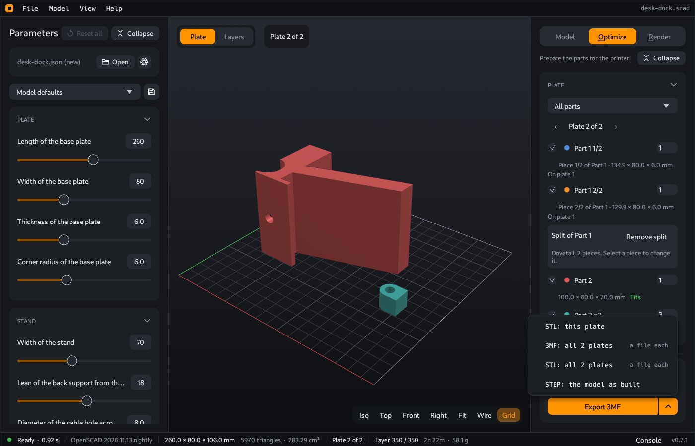

# Export

Export writes a file that other programs can read: a slicer for your 3D printer, or a CAD program.

## How to export

1. Open the **Optimize** tab. **Export 3MF** is at the bottom of the right panel.
2. Hold the mouse on **Export 3MF**. The text tells what the file will contain, for example "Plate: 4 parts, 6 copies. Bed chamfer, 3 teardrops."
3. Click **Export 3MF** to write the current plate as a 3MF file. For a different file, click the arrow at the right of **Export 3MF**. A menu opens above the button. Click an item in the menu.
4. Select a place and a name for the file. The proposed name is the model name. When a parameter set is active, the set name is added, for example `box-big.stl`. When the parts are on two or more plates, the plate number is added, for example `box-big-plate2.stl`. The dialog opens in the folder of your last export. Before your first export, it opens in the folder of the model.

The **Model** menu of the menu bar has the export commands too: **Export STL (binary)**, **Export 3MF** and **Export STEP (AP214, faceted)**. You can use them in all three tabs. They write the same files as **STL: this plate**, **Export 3MF** and **STEP: the model as built**.

## What is in the file

| Command | What the file contains |
|---|---|
| **Export 3MF** | The current plate of the [Optimize](Optimize) tab: the print parts on the bed, in print position, with the print fixes that are on. Each print part is one object, and each copy is one item, so your slicer shows them as separate objects. The file also contains the values of all parameters. |
| **STL: this plate** | The same plate as an STL file. |
| **3MF: all 2 plates**, **STL: all 2 plates** | These items show when the parts are on two or more plates. The number is the number of plates. They write one file for each plate, for example `box-plate1.3mf` and `box-plate2.3mf`. |
| **STEP: the model as built** | The model as OpenSCAD made it, for a CAD program. It has no plate and no print fixes. When the dropdown of the **Plate** card shows one part, the file contains only that part, in its place in the model. |
| **Multicolor 3MF: PrusaSlicer 2.9**, **Multicolor 3MF: OrcaSlicer** | These items show when the model has named parts. See [Multicolor prints](Multicolor-prints). |

You do not have to open the **Optimize** tab before an export from the **Model** menu. When the plates are not ready, CoCAD prepares them first. A model that you did not change in the **Optimize** tab gives all parts in the rotation of the model, with no print fixes, on the print area from **File > Settings > Printer**.

A part that is too large for the print area is on no plate, so it is not in the STL or the 3MF file. The message after the export names each part that it left out. [Split](Optimize#split-a-part-that-is-too-large) it in the **Optimize** tab, or set a larger print area. When no part is on a plate, **Export 3MF** and the plate items of the menu are not available. Hold the mouse on **Export 3MF** to see the reason. **STEP** still works.

For a print in more than one color, see [Multicolor prints](Multicolor-prints).

## Which format

| Format | Use it for |
|---|---|
| **STL** | A slicer for a 3D printer. It contains only the triangles of the surface. |
| **3MF** | A slicer for a 3D printer, when you want separate objects and your values in the file |
| **STEP** | A CAD program. STEP has flat faces in place of triangles. A closed model becomes one solid that CAD programs can edit. |

## Check the model before you export

The **Mesh** card of the **Model** tab and the status bar show data about the model:

- **Size** in mm: width × depth × height.
- **Volume** in cm³.
- **Triangles**: the number of triangles of the surface.
- **Open edges**: the status bar shows them only when the model has a problem. A model with open edges is not a closed solid, and a slicer can give wrong results for it.

Two more checks in the 3D view:

- Faces that point the wrong way show in **purple**.
- Press `W` to see the triangles of the surface (wireframe).

The **Check** card of the **Optimize** tab lists the print problems: overhangs, bridges and parts that are too large. See [Optimize](Optimize#check).

## What the export does not contain

Part colors, explode and section are for the view only. The parts with a `%` mark in the model ([reference parts](Parts#reference-parts)) are never in an export.

---

**For technical readers.** The STL is binary. The 3MF holds the parameter values in its metadata. Each object of a plate 3MF has the name of its print part. The STEP file is AP214: coplanar triangles become planar faces, and a closed mesh becomes one `FACETED_BREP` solid. An open mesh becomes an open shell. To export without the window, see [Command line](Command-line).
