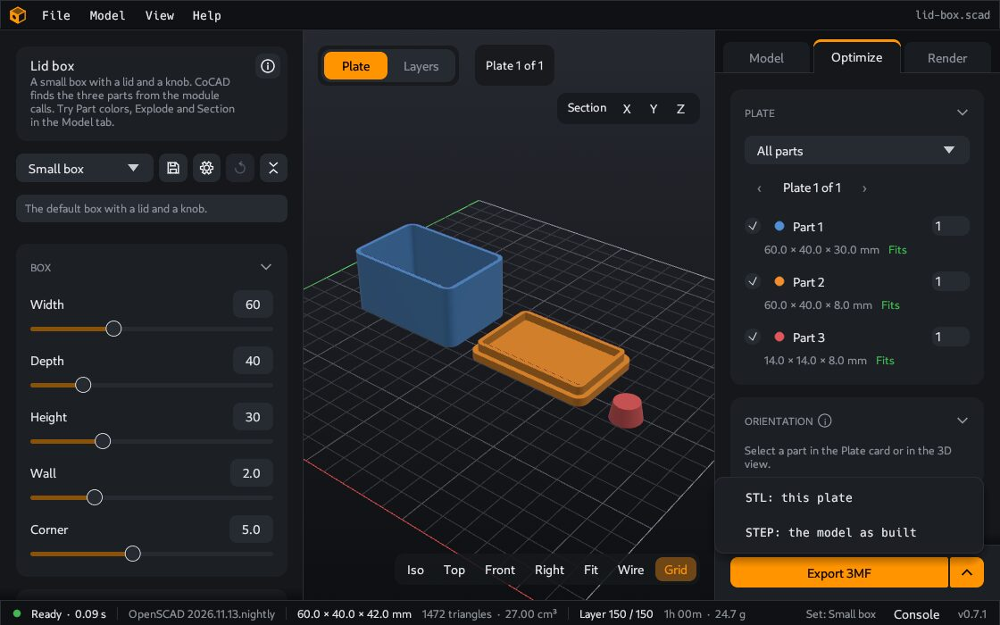

# Export

Export writes the model to a file that other programs can read: a slicer for your 3D printer, or a CAD program.

## How to export

1. Open the **Model** tab on the right.
2. In the **Export** card, click **STL**, **3MF** or **STEP**.
3. Select a place and a name for the file. The proposed name is the model name. When a parameter set is active, the set name is added, for example `box-big.stl`. The dialog opens in the folder of your last export. Before your first export, it opens in the folder of the model.

The **Model** menu has the same commands.

## Which format

| Format | Use it for | What is in the file |
|---|---|---|
| **STL** | A slicer for a 3D printer | The surface of the model as triangles |
| **3MF** | A slicer for a 3D printer, when you want to keep your values with the file | The triangles, and the values of all parameters |
| **STEP** | A CAD program | Flat faces in place of triangles. A closed model becomes one solid that CAD programs can edit. |

For a print in more than one color, see [Multicolor prints](Multicolor-prints).

## Check the model before you export

The status bar at the bottom shows data about the model:

- **Size** in mm: width × depth × height. Make sure that the part fits on your printer.
- **Volume** in cm³.
- **Triangles**: the number of triangles of the surface.
- **Open edges**: this shows only when the model has a problem. A model with open edges is not a closed solid, and a slicer can give wrong results for it.

Two more checks in the 3D view:

- Faces that point the wrong way show in **purple**.
- Press `W` to see the triangles of the surface (wireframe).

## What the export does not contain

Part colors, explode and section are for the view only. The export always contains the model as OpenSCAD made it.

---

**For technical readers.** The STL is binary. The 3MF holds the parameter values in its metadata. The STEP file is AP214: coplanar triangles become planar faces, and a closed mesh becomes one `FACETED_BREP` solid. An open mesh becomes an open shell. To export without the window, see [Command line](Command-line).
