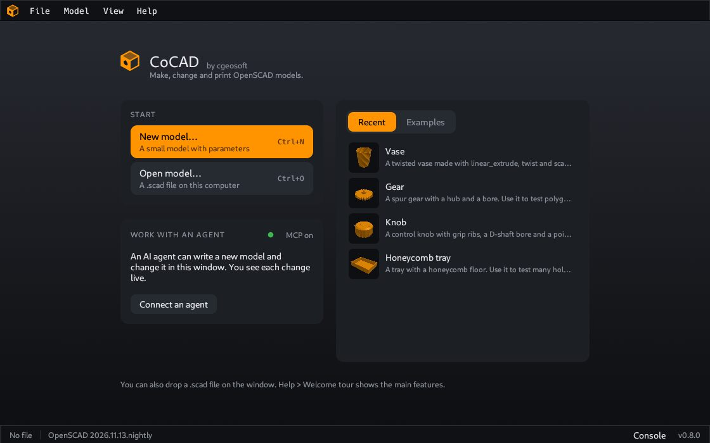

# First steps

This page shows how to open a model and how to look at it.

## The welcome tour

At the first start, a welcome tour shows the main features one step at a time. Click **Next** and **Back**, or press the Right and Left arrow keys. Press Esc to close the tour.

To see the tour again, use **Help > Welcome tour**.

## Open a model

A model is a file with the extension `.scad`. You can open it in four ways:

- Press Ctrl+O, or use **File > Open…**, and select the file.
- Drop the file on the CoCAD window.
- Select a model in the list of recent models. The **File** menu shows the last 10 models. The window shows the same list when no model is open.
- Use **File > Examples** to open a sample model.

If you have no model, start with an example. **File > Examples > Gear** is a good first model.

> The examples are copies in the settings folder of CoCAD. You can change them. Your changes stay.

## The window

| Area | Position | Content |
|---|---|---|
| Menu bar | Top | All commands: **File**, **Model**, **View** and **Help** |
| Parameters panel | Left | The values that you can change. See [Change the parameters](Parameters). |
| 3D view | Middle | The model |
| Sidebar | Right | Three tabs: **Model**, **Slice** and **Photo** |
| Status bar | Bottom | The state of the model, its size and the **Console** button |

The three tabs of the sidebar change what the 3D view shows:

- **Model**: the shape of the model, the export buttons and the [parts](Parts).
- **Slice**: the [print layers](Slice-preview).
- **Photo**: a [photo](Photo-render) of the part.

## Move the view

| You do this | The view does this |
|---|---|
| Drag with the left mouse button | Turns around the model |
| Drag with the right or the middle button | Moves to the side |
| Hold Shift and drag with the left button | Moves to the side |
| Turn the mouse wheel | Moves nearer or farther |
| Double click, or press `F` | Shows the full model |

The buttons at the bottom of the 3D view set a fixed direction: **Iso**, **Top**, **Front** and **Right**. **Fit** shows the full model. **Wire** shows the triangles of the model. **Grid** shows or hides the floor grid.

## The status bar

The status bar shows, from left to right:

- The state of the render and the time it took. **Ready** means that the model is up to date.
- The OpenSCAD version.
- The size of the model in mm, the number of triangles and the volume.
- The number of open edges, if the model has some. See [Export](Export#check-the-model-before-you-export).
- The **Console** button. It shows the messages of OpenSCAD. Look there when a model shows an error.

## When the model file changes

If you or another program change the `.scad` file on disk, CoCAD loads the model again. The values that you changed in CoCAD stay.

## Next step

Go to [Change the parameters](Parameters).
