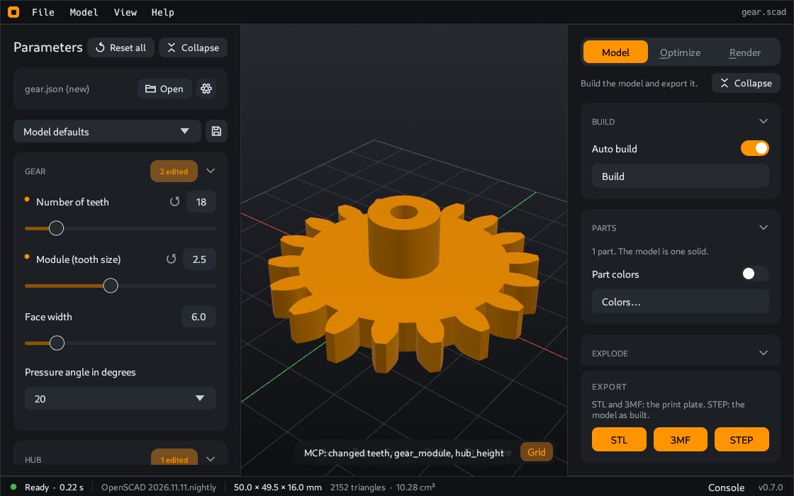

# CoCAD user guide

CoCAD is a desktop app for OpenSCAD models. You open a model, change its values with sliders, and see the result at once. Then you can prepare the parts for your 3D printer, look at the print layers, export the files, and make a photo of the part.

You do not need to write code to use CoCAD. A model file (`.scad`) contains the shape and a list of values that you can change, for example a width or a number of teeth. CoCAD shows these values as sliders, lists and switches.

## Start here

| Step | Page |
|---|---|
| 1 | [Install](Install): get an OpenSCAD development snapshot and CoCAD on your computer |
| 2 | [First steps](First-steps): open a model and move the view |
| 3 | [Change the parameters](Parameters): use the sliders to change the model |
| 4 | [Prepare a model for printing](Prepare-a-model-for-printing): a full example, from the model to the print files |
| 5 | [Export](Export): write a file for your printer or your CAD program |

## What you can do

| Task | Page |
|---|---|
| Keep sets of values, for example "small" and "big" | [Parameter sets](Parameter-sets) |
| See the separate parts of a model, color them, move them apart, cut them open | [Parts](Parts) |
| Write an STL, 3MF or STEP file | [Export](Export) |
| Print a model in more than one color | [Multicolor prints](Multicolor-prints) |
| Put the parts on the bed, turn them, change them for the printer, split large parts, and see the print layers | [Optimize](Optimize) |
| Make a studio photo of the part | [Render](Render) |
| Let an AI assistant change the model for you | [AI assistant](AI-assistant) |
| Change the theme, the OpenSCAD program, the default printer and other options | [Settings](Settings) |
| See what data CoCAD sends, and stop it | [Privacy](Privacy) |

## Help

- [Keyboard and mouse](Keyboard-and-mouse): all keys on one page.
- [Problems and answers](Problems-and-answers): what to do when something does not work.
- [Glossary](Glossary): the meaning of words such as build, plate, bridge and STEP.

## Advanced topics

These pages are for technical readers. You do not need them for the usual work.

| Topic | Page |
|---|---|
| Use CoCAD from a terminal, without the window | [Command line](Command-line) |
| All tools and rules of the MCP server | [MCP reference](MCP-reference) |
| Write a model that works well in CoCAD | [Write models for CoCAD](Write-models-for-CoCAD) |
| How CoCAD divides a model into parts | [How CoCAD finds the parts](How-CoCAD-finds-the-parts) |
| The OpenSCAD program, its backends and the settings folder | [OpenSCAD engine and files](OpenSCAD-engine-and-files) |
| Build CoCAD from the source code, tests and releases | [Build from source](Build-from-source) |

CoCAD has the MIT license. The source code is at <https://github.com/cgeosoft/cocad>. The website is <https://cocad.cgeosoft.com>.
