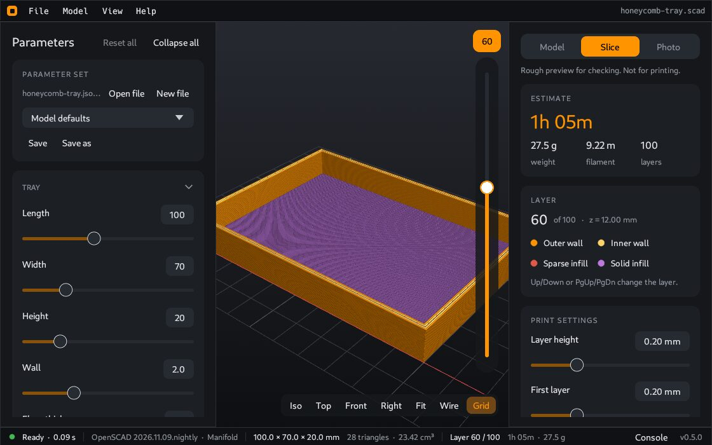

# Slice preview

A 3D printer builds a part in thin layers. The **Slice** tab cuts the model into these layers and shows the paths that a printer would follow. Use it to see how the part would print, before you open your slicer.

> The slice preview is a rough check. It does not write a file for the printer. To print, export the model and use a slicer program.

## Open the slice view

Click the **Slice** tab on the right, or press `S`. Press `S` again to go back to the model.

## What you see

The paths show as round strands with the real line width and layer height. Each kind of path has its color. The **Layer** card shows the legend:

| Path | Meaning |
|---|---|
| Outer wall | The outside surface of the part |
| Inner wall | The walls behind the outer wall |
| Sparse infill | The open pattern that fills the inside |
| Solid infill | The closed layers at the top and the bottom |

## Move through the layers

- Move the layer slider.
- Or press Up and Down, or PgUp and PgDn.

The card shows the layer number and its height (z) in mm.

**Show model ghost** shows the shape of the model around the layers.

## The estimate

The **Estimate** card on top shows the print time, the weight in grams, the filament length in meters and the number of layers. These are rough values.

## Print settings

| Setting | Meaning |
|---|---|
| Layer height | The thickness of each layer |
| First layer | The thickness of the first layer |
| Line width | The width of one strand, 0.2 to 1.2 mm |
| Walls | The number of walls, 0 to 6 |
| Infill | How full the inside is, 0 to 100 % |
| Top and bottom layers | The number of solid layers at the top and the bottom |
| Speed | The print speed, 10 to 300 mm/s. It changes the time estimate. |

The view updates when you change a setting. Most models slice in less than 50 ms.

## Limits

The preview has no travel moves, no supports and no bridges. It does not write G-code.

Explode and section do not apply here. The **Slice** tab shows the model at its real position.

---

**For technical readers.** `cocad slice model.scad` gives the same estimate in a terminal. See [Command line](Command-line).
