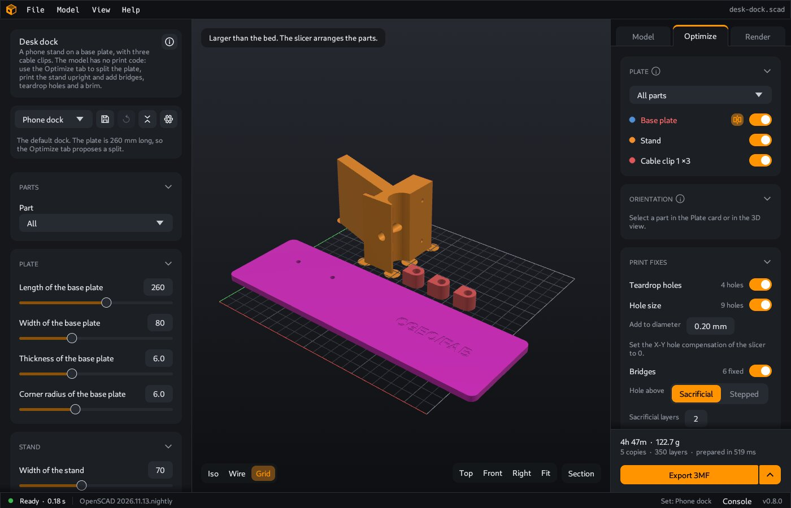
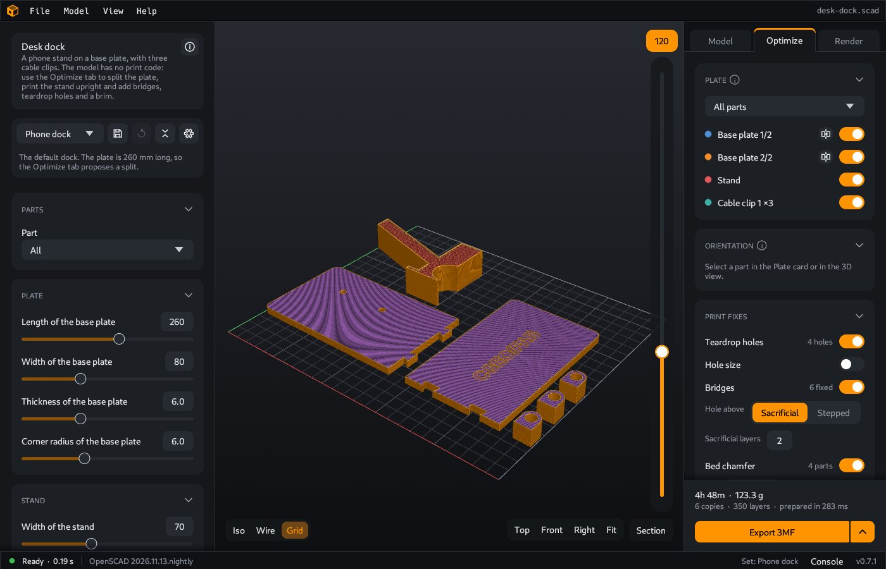

# Optimize

The **Optimize** tab prepares the parts of a model for a 3D printer. It puts the parts on the bed of your printer, turns them, changes the shape where a printer has problems, and shows the print layers. **Export 3MF** at the bottom of the tab writes the result as a 3MF file. Its menu also writes STL files.

The model file does not change. CoCAD changes only the parts that it writes for the printer.

For a full example with pictures of each change, see [Prepare a model for printing](Prepare-a-model-for-printing).

## Open the tab

Click **Optimize** on the right, or press `O`. Press `O` again to go back to the **Model** tab. Point to the tab name to see its key.

When you open the tab, CoCAD prepares the plate. The **Plate** card shows "Preparing the plate…" and the time. For the print fixes and the splits, CoCAD runs OpenSCAD in the background, so this can take some seconds. CoCAD keeps the results of these slow steps. When you change one value, CoCAD makes again only the parts that the change touches. The last line of the tab shows the time of the last run, for example "Prepared in 240 ms".

## Print parts

The rows of the **Plate** card are the print parts. CoCAD makes them from the [parts](Parts) of the model:

- Parts with the same shape are one row with a count, for example "Part 3 ×3". The plate gets one copy for each count.
- Parts that overlap in volume cannot be separate printed pieces. CoCAD joins them into one print part with the name "Part 1 + Part 2". Parts that only touch, for example a lid on a box, stay separate.
- The parts of a multicolor model are the colors of one object. They are one print part with the name of the model. See [Multicolor prints](Multicolor-prints).
- Each piece of a [split](#split-a-part-that-is-too-large) part is a print part, for example "Part 1 1/2".
- Reference parts (the parts with a `%` mark in the model) are never print parts. See [Parts](Parts#reference-parts).

## Plate and Layers views

Two buttons at the top left of the 3D view change what the view shows:

| View | What it shows |
|---|---|
| **Plate** | The parts on the bed, in print position. Each print part has its own color. The grid is the print area of your printer. |
| **Layers** | The print layers of the plate. See [Layers](#layers). |

The label next to the buttons shows the plate, for example "Plate 1 of 2". The **Layers** card has the same two buttons.

In the **Plate** view, click a part to select it. The **Plate** card marks its row, and the **Orientation** card shows its values. Click the background to clear the selection.

The Optimize tab shows no explode and no reference parts. **Fit** and the `F` key show the full bed.

The **Section** bar at the top right of the 3D view cuts the plate across the axes of the bed. The cuts that you turn on in the other tabs stay on. The plate has its own positions, at first the center of the plate. The **Layers** view shows the cut too. **Export 3MF** does not use the cut. See [Section](Parts#section).

## The cards

The tab has these cards, from top to bottom: **Plate**, **Orientation**, **Print fixes**, **Check**, **Layers**, **Printer** and **Print settings**. **Export 3MF** is below them, at the bottom of the tab. See [Export](Export).

Click the header of a card to close it or to open it. A closed card shows a short value in its header, for example the print time in the **Layers** card. CoCAD remembers which cards are closed. The **Export** card does not close.

### Plate

- The dropdown at the top: **All parts** (the default), or one print part. With one part, the plates hold only this part and its copies.
- The plate number, for example **Plate 1 of 2**. The arrows show the plate before and the next plate. The 3D view, the layers and the export use this plate.
- One row for each print part:
  - The check box. Clear it to not print the part, for example when you printed it already.
  - The color of the part on the plate, and its name. Click the name to select the part.
  - The number of copies. Empty means the count in the model. Type a number to print more or fewer copies, up to 999.
  - Below the name: the size of the part in print position, and its status.

| Status | Meaning |
|---|---|
| **Fits** | The part fits the print area. The Check found no problems. |
| **3 problems** | The **Check** card lists problems of this part. |
| **On plate 2** | The part is on a different plate. |
| **Too large** | The part does not fit the print area. A **Split** section shows below the row. |
| **Not printed** | You cleared the check box. |
| **Not on the plates** | The dropdown shows a different part, or the copies are 0. |

When a fix found a place that it did not change, the row shows "1 skipped". Hold the mouse on it to see the place and the reason.

#### More than one plate

CoCAD puts the parts in rows on the bed, the largest first, with a gap between them. It can turn a part by 90 degrees on the bed to fit it. This does not change how the part prints. The parts are in the center of the bed.

When the parts do not fit on one plate, CoCAD fills plate 1, then plate 2, and so on. The menu of the **Export** card then has **3MF: all 2 plates** and **STL: all 2 plates**, with the number of plates. These items write one file for each plate. To open the menu, click the arrow at the right of **Export 3MF**.

#### Split a part that is too large

A part that does not fit the print area shows a **Split** section with a proposal:

- The joint: **Flat**, **Pins** or **Dovetail**. CoCAD proposes a dovetail for a flat part (thinner than 10 mm) and pins for other parts.
- **Clearance**: the total gap of the joint, 0.20 mm by default. Each side gets one half.
- **Cut 1 at x**: the position of each cut, in mm. Type a value or drag the number to move the cut.
- The size of each piece, for example "1/2: 135.0 × 80.0 × 6.0 mm". A size in red does not fit the print area.

Click **Split** to cut the part. **Reset** goes back to the proposal. When you select a different joint, CoCAD finds new cut positions for it.

After the split, each piece is a print part, for example "Part 1 1/2" and "Part 1 2/2". A **Split of Part 1** box shows the joint and the number of pieces. Select a piece to change the values of the split. **Remove split** makes the part whole again.

| Joint | Shape | After the print |
|---|---|---|
| **Flat** | Two flat faces | Glue the pieces together. |
| **Pins** | Holes in the two faces. CoCAD adds the pins to the plate as a print part, for example "Part 1 pin ×4". The pins have a diameter of 4 mm and go 5 mm into each piece. | Push the pins in and glue the pieces. |
| **Dovetail** | Tabs across the cut, in the plane of the part. A tab is 8 mm wide at the cut, 12 mm wide at its end and 5 mm long. The tabs are 30 mm apart. | Push the pieces together and glue them. |

When a cut face has no room for pins or tabs, that cut is a flat cut. The **Plate** card tells you, for example "the cut at 130.0 mm has no room for pins. It is a flat cut."

When no cuts make the part fit, the section says so. Turn the part with a [custom orientation](#orientation), or use a larger print area. When the part fits on a different side, the **Plate** card tells you so. Then click **Select face** in the **Orientation** card and click that side.

### Orientation

Select a part first, in the **Plate** card or in the 3D view.

- **Custom orientation**: on by default, with **Auto**. When you turn it off, the part keeps the rotation of the model. CoCAD then only moves its lowest point down to the bed.
- When it is on, two choices show:
  - **Auto**: CoCAD puts the part on its best face. It compares the flat faces of the outer shape of the part. It prefers less overhang, more area on the bed and a lower part. When the rotation of the model is almost as good, the part keeps it.
  - **Select face**: click a face of the selected part in the 3D view. That face goes on the bed.
- **Turn 90°** turns the part by 90 degrees on the bed.

With **Auto** and **Select face**, CoCAD also turns the part on the bed, so that its long side is along the long side of the bed.

CoCAD stores the orientation for each model and each part name. It stores the direction in the model that points down, so the choice stays when the model builds again with different values.

The model gives no orientation. Only you know which face must look good, and in which direction the part must be strong.

### Print fixes

The print fixes change the shape of the print parts, so that they print better. All fixes are off by default. CoCAD stores the switches and the values for each model. The fixes apply to all print parts. When a fix is on, its row shows the number of places that it changed on the current plate.

| Fix | What it does | Values |
|---|---|---|
| **Teardrop holes** | A round hole with a horizontal axis gets a 45 degree point at the top. The top of the hole then needs no support. | |
| **Hole size** | A round hole with a vertical axis prints smaller than in the model. The hole gets the diameter of the model, plus a value. | **Add to diameter**: 0 to 1 mm, 0.2 mm by default |
| **Bridges** | A bridged ceiling over a round hole starts on straight edges. A blind hole that goes up gets a 45 degree cone at its end. | **Hole above**: **Sacrificial** or **Stepped**. **Sacrificial layers**: 1 to 10, 2 by default. |
| **Bed chamfer** | The edges on the bed get a 45 degree chamfer, in whole layers. The chamfer hides the elephant foot of the first layers. | **Size**: 0.1 to 2 mm, 0.4 mm by default |
| **Brim on small islands** | A small area of the first layer gets a brim of one layer, so that it stays on the bed. | **Width**: 1 to 20 mm, 5 mm by default. **Gap**: 0.2 to 5 mm, 1 mm by default |
| **Mouse ears** | Each sharp corner of a large area of the first layer gets a disk of one layer. The disk holds the corner on the bed, so that the part does not lift there. | **Diameter**: 5 to 30 mm, 15 mm by default. **Min size**: 20 to 300 mm, 100 mm by default |

With the bed chamfer on, the card shows "Set the elephant foot compensation of the slicer to 0." Without this, the bed edges get two corrections.

**Hole size** changes round holes from 1 to 40 mm in diameter. OpenSCAD makes a round hole from flat faces, with the corners on the circle. The flat faces are inside the circle, so the hole is smaller than its diameter. The fix moves the flat faces out to the circle, and then adds the value. With 0, it only moves the faces. Some rules:

- A hole with six faces can be a pocket for a nut. Its faces only move out by the value.
- A blind hole does not get deeper.
- When the wall around a hole is too thin, CoCAD does not change the hole. The row shows it as skipped.
- Pins and other round shapes that point out are not changed.
- The pin holes of a split are not changed. The **Clearance** of the split sets their fit.

With the fix on, the card shows "Set the X-Y hole compensation of the slicer to 0." Without this, the holes get two corrections. The correct value depends on your printer and material. Print a test part with a hole, measure it, and set the value.

**Mouse ears** are for large flat parts. An area of the first layer gets ears when its long side is **Min size** or more. Round corners, inside corners and the corners of holes get no ear. Two corners that are nearer than one diameter get one ear between them. The ears do not go into the holes of the part, and they stay inside the print area. A small area gets no ears: **Brim on small islands** holds it. After the print, cut the ears off.

The [guide](Prepare-a-model-for-printing#4-turn-on-the-print-fixes) shows each fix before and after, and tells when to use it.

When a fix finds a place that it cannot change, it leaves the place as it is. The card then shows "1 place skipped". Hold the mouse on it to see the places and the reasons, for example "wall above too thin".

### Check

The **Check** card lists the problems that stay after the fixes. It shows the problems of the parts on the current plate, and of the parts that are too large.

| Problem | Meaning |
|---|---|
| **Overhang** | Faces that point down and are steeper than the overhang limit. They need support. |
| **Long bridge** | A flat ceiling that is longer than the bridge limit. |
| **Thin wall** | A wall that is thinner than the **Line width** of the print settings. The printer cannot make it with one line. Make the wall thicker in the model. |
| **Arc in a bridge** | A flat ceiling with a round outline. Turn on **Bridges**. |
| **Small island** | A small area of the first layer: thinner than 3 mm, or smaller than 25 mm². Turn on **Brim on small islands**. |
| **Too large** | The part does not fit the print area. |

Each line shows the size and the height of the place. Click a problem to select its part and to show its faces in the 3D view. While the card is open, the 3D view shows the faces of all problems in purple. The card shows at most 80 problems.

### Layers

The **Layers** card is the slice preview of the current plate, with the fixes. Click **Layers** to see the layers in the 3D view.

- The estimate: the print time, the weight in grams, the filament length in meters and the number of layers. These are rough values for the current plate only.
- The current layer, and its height (z) in mm.
- The colors of the paths:

| Path | Meaning |
|---|---|
| Outer wall | The outside surface of the part |
| Inner wall | The walls behind the outer wall |
| Sparse infill | The open pattern that fills the inside |
| Solid infill | The closed layers at the top and the bottom |

To change the layer, move the slider at the right edge of the 3D view, or press Up and Down. PgUp and PgDn move 10 layers.

**Show model ghost** in the **Print settings** card shows the plate around the layers.

> The slice preview is a rough check. It has no travel moves, no supports and no bridges. It does not write G-code. To print, export the plate and use a slicer program.

### Printer

The print area of your printer for this model: width, depth and height in mm. Select a printer in the dropdown, or type the values. When the values are not the same as a printer in the list, the dropdown shows **Custom**.

| Printer | Print area (mm) |
|---|---|
| Prusa MK4S | 250 × 210 × 220 |
| Prusa CORE One | 250 × 220 × 270 |
| Prusa MINI+ | 180 × 180 × 180 |
| Creality K1C | 220 × 220 × 250 |
| Creality Ender-3 V3 | 220 × 220 × 250 |

A model that you open for the first time gets the default print area of **File > Settings > Printer**. The default is 220 × 220 × 250 mm. CoCAD stores the print area with the other Optimize values of the model. See [Settings](Settings#printer).

### Print settings

| Setting | Default | Meaning |
|---|---|---|
| Layer height | 0.2 mm | The thickness of each layer, 0.05 to 0.6 mm |
| First layer | 0.2 mm | The thickness of the first layer, 0.05 to 0.6 mm |
| Line width | 0.45 mm | The width of one strand, 0.2 to 1.2 mm |
| Walls | 2 | The number of walls, 0 to 6 |
| Infill | 15 % | How full the inside is, 0 to 100 % |
| Top and bottom layers | 4 | The number of solid layers at the top and the bottom, 0 to 10 |
| Speed | 80 mm/s | The print speed, 10 to 300 mm/s. It changes the time estimate. |
| Overhang limit | 45° | A face that points down and is steeper than this angle from the vertical is an overhang, 20 to 80° |
| Bridge limit | 12 mm | A longer bridge is a problem. The **Bridges** fix does not change it. 1 to 100 mm |
| Gap | 10 mm | The distance between the parts on a plate, 0 to 50 mm |

The layer heights also set the steps of the bed chamfer, the height of the brim and the thickness of the sacrificial layers.

## Limits

- The plate layout uses the outer rectangle of each part. Your slicer can arrange the parts again.
- A split cuts with parallel planes across one axis of the part. You move a cut with its number field, not in the 3D view. The joints are flat, pins and dovetail.
- **Teardrop holes** changes round holes with a diameter of 1 to 40 mm, with an axis that is less than 10 degrees from the bed.
- **Bridges** changes only ceilings with a round outline, and only when the bridge is not longer than the bridge limit.
- The estimate of the **Layers** card is for the current plate only. `cocad slice` gives the sum of all plates.

---

**For technical readers.** CoCAD finds the places of the fixes in Rust, and does the cuts and the unions with OpenSCAD and the Manifold backend. `cocad export` and `cocad slice` use the same print preparation, with the Optimize values that the app stored for the model. The MCP tools `get_optimize` and `set_optimize` read and change these values. See [Command line](Command-line) and [MCP reference](MCP-reference).
