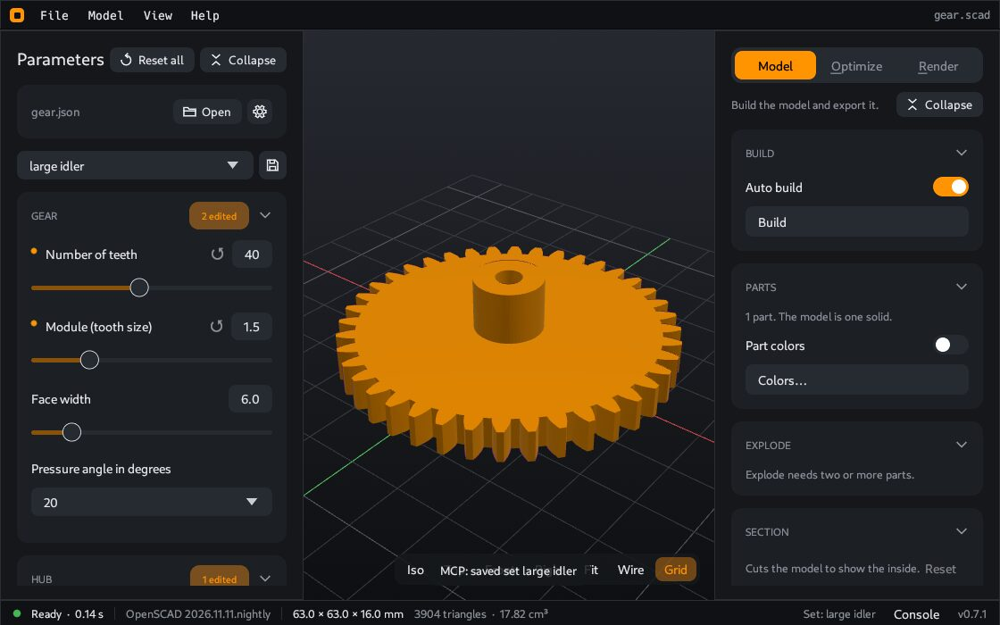

# Parameter sets

A parameter set is a named group of values for one model. For example, a box model can have the sets "small", "big" and "for the workshop". You select a set and all sliders move to the saved values.



## Where to find them

The top of the **Parameters** panel has two items:

- A **card** with the name of the sets file. All sets of a model are in one file.
- A **list** of the sets, below the card.

## Usual tasks

| Task | How |
|---|---|
| Load a set | Select it in the list. |
| Go back to the values of the model file | Select **Model defaults** in the list. |
| Save your values as a new set | Click the gear button, then **New set…**. Type a name. |
| Save your changes to the selected set | Click the disk button. |
| Delete the selected set | Click the gear button, then **Delete**. Confirm in the window that opens. |
| Use sets from a different file | Click **Open** and select a `.json` file. |
| Start a new sets file | Click the gear button, then **New file…**. Select a place and a name. |

The disk button is orange while the set has changes that are not saved.

If no set is selected, the disk button asks for a name and makes a new set.

## What CoCAD remembers

- CoCAD remembers the sets file of each model. If you did not select one, it uses a file with the name of the model next to the model: `box.json` for `box.scad`.
- When you open a model, CoCAD loads the set that you used last for that model. If there is no record, it loads the first set of the file.
- If **Model defaults** was your last selection, the values stay at the defaults of the model.
- CoCAD also remembers your last parameter values for each model. With **Model defaults**, it loads these values. With a set, it loads them only if you did not save your changes to the set. The set then shows as edited.
- CoCAD also remembers the settings of the right panel for each model: the tab (Model, Slice or Photo), auto render, the print settings, the photo settings, part colors and explode.
- A new sets file does not exist on disk until your first save.

## Auto save

With auto save, CoCAD writes your changes to the selected set a moment after your last change (0.6 seconds).

1. Open **File > Settings**.
2. Select the **Parameter sets** page.
3. Turn on **Auto save**.
4. Click **Save**.

Auto save is off by default. With **Model defaults** selected, it saves nothing.

## Descriptions

A sets file can tell what the model and each set are for:

- The **card** shows the title and the description of the file below the file name.
- When you select a set that has a description, an **info box** below the list shows it.

CoCAD only shows this text. You cannot edit it in CoCAD. To add it, edit the `.json` file in a text editor (see below).

## When the sets file changes on disk

If another program changes the sets file, the list of sets updates. The active set gets the new values, unless you have changes in it that are not saved.

---

**For technical readers.** The file uses the format of the OpenSCAD Customizer, so OpenSCAD reads it too: `openscad -p sets.json -P big`. The [command line](Command-line) of CoCAD uses the same sets with `-P` and `-p`.

To add descriptions, add text fields to the file:

```json
{
    "fileFormatVersion": "1",
    "title": "Box",
    "description": "A box with a lid.",
    "author": "Your name",
    "parameterSets": {
        "big": {
            "$title": "Big box",
            "$description": "For the workshop. Prints in 6 hours.",
            "width": "80"
        }
    }
}
```

- At the top level, `title` and `description` show in the card. Other text and number fields (for example `author`, `version`, `url`) show as "name: value" lines. A web address is a link.
- In a set, a key that starts with `$` is a description field, not a parameter: `$title`, `$description` and others such as `$note`. OpenSCAD ignores these keys, because no Customizer parameter has a name that starts with `$`.
- When CoCAD saves a set, the `$` fields of the set stay.
