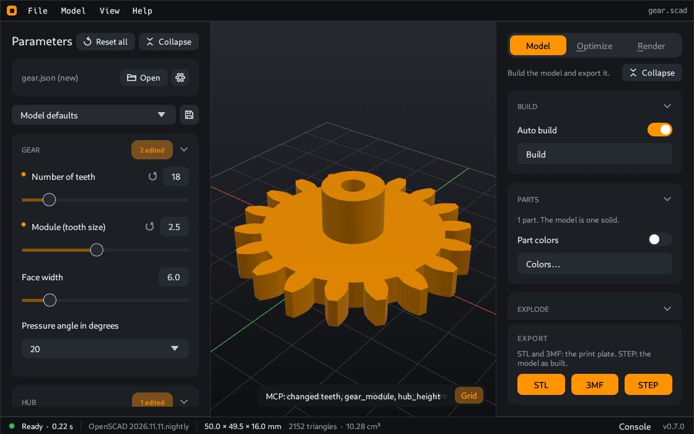

# Change the parameters

A parameter is a value of the model that you can change, for example a width, a wall thickness or a text. The author of the model decides which parameters exist and which limits they have.

The **Parameters** panel on the left shows all parameters of the open model.

## The controls

| Control | Use |
|---|---|
| Slider | A number between two limits. Drag the slider, or type the number in the box. |
| Dropdown list | One value from a fixed list |
| Switch | On or off |
| Text box | A text, for example a label on the part |
| Number boxes in a row | A value with more than one number, for example a position with X and Y |

The parameters are in groups. Click the header of a group to close or open it. **Collapse** at the top closes all groups. **Expand** opens them again. CoCAD remembers the closed groups for each model.

If the author wrote a description for a parameter, the panel shows the description as the label.

## See the result

When you change a value, CoCAD makes the model again. This is the "build". The status bar at the bottom shows the state and the time.

A build of a large model can take a long time. In that case you can stop the automatic build:

1. Open the **Model** tab on the right.
2. Turn off **Auto build** in the **Build** card.
3. Change all the values that you want.
4. Click **Build**, or press `F5`.

While **Auto build** is off, the status bar shows "Parameters changed. Press F5." after a change.

## Go back to the initial values

- An orange dot marks a value that you changed.
- The arrow next to the value sets this one value back.
- The header of a group shows how many values you changed in it, for example "2 edited".
- **Reset all** at the top sets all values back.

## Keep your values

Your values stay while the model is open. To keep them for later, save them as a [parameter set](Parameter-sets).

## When a model has no parameters

Some models have no parameters. You can still look at the model, prepare it for printing, export it and make a photo.

---

**For technical readers.** CoCAD reads the same comments as the OpenSCAD Customizer. See [Write models for CoCAD](Write-models-for-CoCAD).
