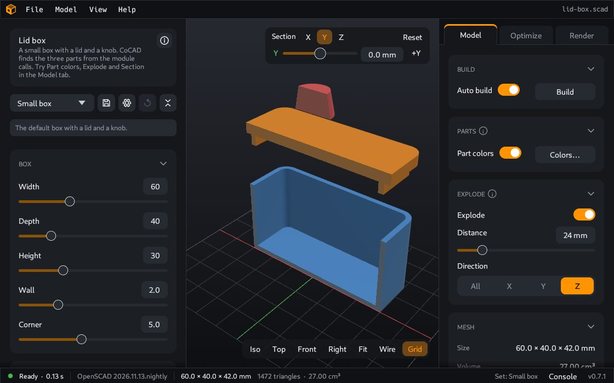

# Parts

Many models have more than one part, for example a box, a lid and a knob. CoCAD finds the separate parts of a model. Then you can give each part a color, move the parts away from each other, and cut the model open to see the inside.

These functions change only what you see. They do not change the files that you [export](Export). To put the parts on the bed of your printer, use the [Optimize](Optimize) tab.

## The Parts card

The **Parts** card is in the **Model** tab and in the **Render** tab. It shows the number of parts. When the model has [reference parts](#reference-parts), it also shows their number, for example "5 parts, 3 not printed".

While CoCAD looks for the parts, the card shows "Finding the parts…" or "Building the parts…". The parts have the names "Part 1", "Part 2" and so on, unless the model gives them names. A model with a `part` list, for example `part = "all"; // [all:All, lid:Lid]`, gives each part the name from the list. See [Write models for CoCAD](Write-models-for-CoCAD#names-for-the-parts).

## Part colors

- Turn on **Part colors** to show each part in a different color.
- Click **Colors…** to see the list of all parts with their volumes. Click a color to change it. **Reset** gives the part its default color again.
- A color change turns on **Part colors**.
- The colors stay when the model builds again. When you open a different model, CoCAD clears them.

The [photo](Render) also uses the part colors when **Part colors** is on. In the **Render** tab, **Each part** in the **Material** card is the same switch, with the list of part colors in the card.

## Select a part

Click a part in the 3D view to select it. The part shows brighter, with an orange edge. The **Parts** card shows its name, size and volume.

When a part is selected, the view buttons (**Iso**, **Top**, **Front**, **Right**) turn the view around the center of that part. The distance stays. It increases only when the part does not fit.

To clear the selection, click the background or press Esc.

## Focus on a part

Focus helps you to look at one part of a model with many parts.

1. Right click the part. A menu opens.
2. Click **Focus**.

The other parts become transparent, and the view turns around the part in focus. `F`, a double click and the view buttons now fit this part in the view.

To stop, press Esc, or right click and choose **Leave focus**. While a part has the focus, a right click on the background opens a menu with only **Leave focus**.

A right drag still moves the view. If the part menu or the color window is open, Esc closes it first.

The same menu has **Change color…**. It opens a color window for this one part.

## Explode

Explode moves the parts away from each other, as in an assembly drawing. The model must have two or more parts. A model with one part has no **Explode** card.

1. Find the **Explode** card in the **Model** tab or the **Render** tab.
2. Turn on **Explode**, or press `E`.
3. Set the **Distance** in mm.
4. Set the **Direction**: **All** moves the parts away from the center. **X**, **Y** and **Z** move them along one axis only.

A change of the distance or the direction also turns on the explode.

The camera does not move. Press `F` to fit the exploded model in the view.

Details:

- The part that is farthest from the center moves the full distance. The other parts move less. A part at the center does not move.
- When all parts have the same center, for example rings inside rings, the parts make a stack. The largest part does not move. The smallest part moves the full distance.
- The [Optimize tab](Optimize) shows no explode.

## Section

Section cuts the model open, so that you can see the inside. You can cut across the X, Y and Z axes.

1. Find the **Section** bar at the top right of the 3D view.
2. Click **X**, **Y** or **Z** to turn on a cut. A row for the cut shows below.
3. Move the slider of the row, or type the position in mm. A blue rectangle shows where the cut is.
4. Click the side button at the end of the row, for example **+X**, to keep the other side (**−X**).

Details:

- With two or three cuts on, you see only the space that all cuts keep. For example, cuts on X and Y keep one quarter of the model.
- The cut faces show in the color of the part, a little darker.
- **Reset** turns off all cuts and moves them to the center. It shows when a cut is on.
- The cuts stay when you change the tab. The **Model** and **Render** tabs cut the model. The photo shows the cut.
- The **Optimize** tab cuts the plate, across the axes of the bed. The cuts and the sides to keep are the same as in the other tabs. The plate has its own positions. At first, they are at the center of the plate. The **Layers** view shows the cut too.
- No export uses the cut. **Export 3MF** writes the full parts.

## Reference parts

A model can show objects that you do not print, for example a screw, a magnet or the phone on a phone stand. The author of the model marks them with `%`. See [Write models for CoCAD](Write-models-for-CoCAD#parts-that-are-not-printed).

- The **Model** tab shows them in transparent gray.
- The **Parts** card counts them apart from the other parts, for example "5 parts, 3 not printed". When you select one, the card shows "(not printed)".
- They have the name "Reference", or "Reference 1", "Reference 2" and so on.
- They are never on a plate of the [Optimize](Optimize) tab, in an export, in the slice or in the photo.

To see an example, open **File > Examples > Reference part** or **File > Examples > Desk dock**.

## What stays and what goes

| Item | When the model builds again | When you open a different model |
|---|---|---|
| Part colors | Stay | Cleared |
| Selection and focus | Stay, if a part with the same name exists | Cleared |
| Explode distance | Stays | Goes back to the default |
| Section cuts and positions | Stay | Positions go back to the center |

When you change the tab, all of these stay.

---

**For technical readers.** CoCAD finds the parts from the part list of the [model definition](Model-definition), from the module calls of the model, or from the solids of the mesh. A part that is not closed can show no cut face or a wrong cut face. The cut faces need a stencil buffer in the OpenGL driver. See [How CoCAD finds the parts](How-CoCAD-finds-the-parts).
