# Prepare a model for printing

This guide prepares the example model **Desk dock** for a 3D printer, step by step. It uses all cards of the [Optimize](Optimize) tab. For each print fix, it shows the part before and after the fix, tells what the fix does, and tells when to use it.

The desk dock is a phone stand on a base plate, with three cable clips. The model file has no print code. It shows the dock as it stands on the desk. CoCAD does all the print preparation.

## 1. Open the model

Use **File > Examples > Desk dock**.

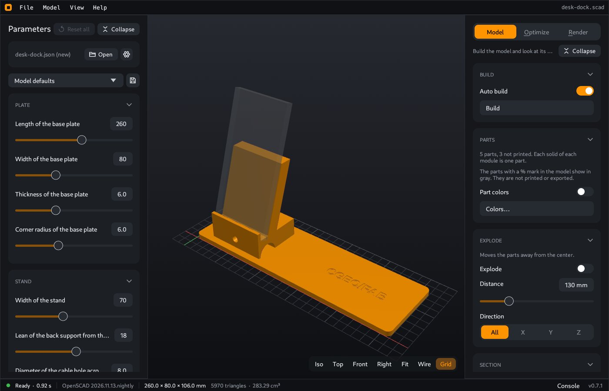

The model has these parts:

- A **base plate**, 260 × 80 × 6 mm. It has the CGEO/FAB wordmark on its top face. In its bottom face, it has four pockets for magnets, and two screw holes with a counterbore for the screw heads.
- A **stand**. It has a cable arch below, a cable hole across it, and two blind pilot holes for the screws from below.
- Three **cable clips** on the back of the stand. They are the same part.
- A **phone**, four **magnets** and two **screws**. They have the `%` mark in the model. They show in transparent gray, and CoCAD never prints them. See [reference parts](Parts#reference-parts).

The **Parts** card shows "5 parts, 3 not printed".

## 2. Open the Optimize tab

Press `O`, or click **Optimize**.

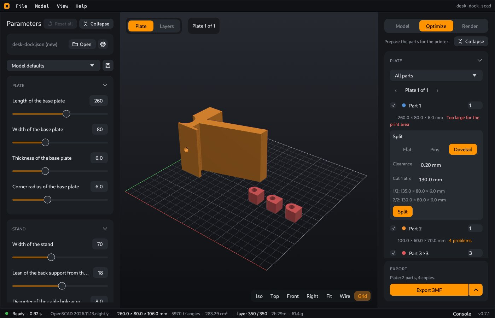

The **Plate** card shows three print parts:

| Print part | What it is | Status |
|---|---|---|
| **Part 1** | The base plate | Too large for the print area |
| **Part 2** | The stand. CoCAD lays it on its side. | 4 problems |
| **Part 3 ×3** | The clips. CoCAD found three parts with the same shape, and puts them on their flat face. | Fits |

The print area is 220 × 220 × 250 mm, the default. The base plate is 260 mm long, so it is on no plate. Below its row, a **Split** section shows a proposal. You split the plate in [step 6](#6-split-the-base-plate).

CoCAD puts each part on its best face. This is **Auto** orientation, the default. See [step 5](#5-check-the-orientation).

The **Check** card lists the problems. Click a problem to see its faces in purple in the 3D view. On its side, the stand has round horizontal holes: the cable hole, and the two pilot holes for the screws. The top of each hole is an overhang. The base plate has bridges with a round outline at its counterbores and magnet pockets.

## 3. Set your printer

Open the **Printer** card. Select your printer in the dropdown, or type the width, depth and height of its print area. This guide uses the default, 220 × 220 × 250 mm.

To set the print area for all models that you open for the first time, use **File > Settings > Printer**. See [Settings](Settings#printer).

## 4. Turn on the print fixes

Open the **Print fixes** card and turn on all four fixes.

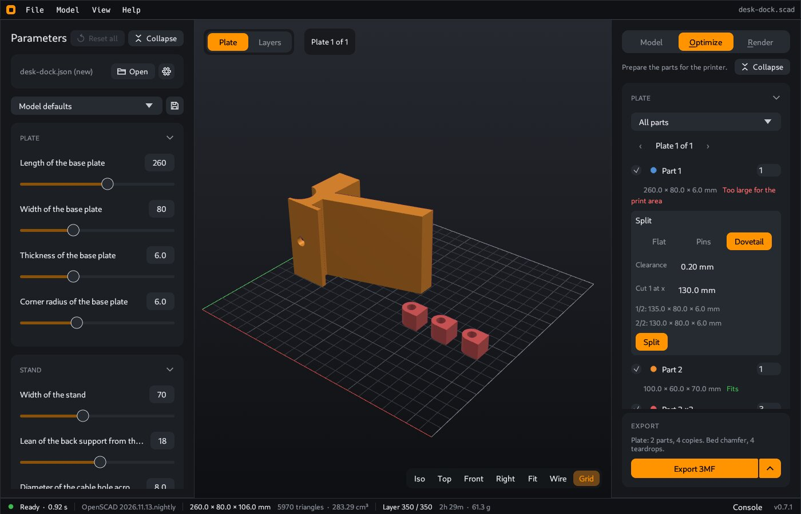

Each fix shows the number of places that it changed. The stand now has the status **Fits**: the fixes removed all its problems. The line of the **Export** card names the fixes for the parts on the plate: "Bed chamfer, 4 teardrops". The base plate is not on the plate yet, so its bridge fixes are not in this line.

The sections below show each fix on a part of the desk dock. The parts are in print position. In the section pictures, the bed is at the bottom.

### Bridges

A printer cannot put plastic on air. Over an empty space, it pulls a strand from one edge to the opposite edge. This is a **bridge**. A bridge prints well from a straight edge. From a round edge, the strands start in the air and sag.

**What the fix does.** On the desk dock, **Bridges** changes the base plate at two kinds of places.

The counterbores of the screw heads open to the bed. Above each counterbore, the screw hole goes on through the plate.

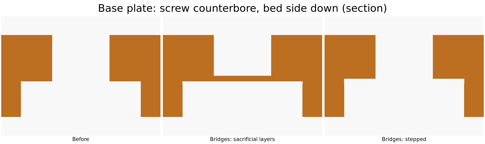

- **Sacrificial** (the default) closes the screw hole with thin layers on the ceiling of the counterbore: 2 layers by default. The bridge is then a full, closed layer. After the print, drill the hole open.
- **Stepped** makes one layer with a slot as wide as the hole, then one layer with a square, then the round hole. Each layer starts on straight edges. You do no work after the print.

The last layer under each round ceiling gets a square outline that holds the circle. The bridge then starts on the straight edges of the square. The plate gets this square at the two counterbores and at the four magnet pockets.

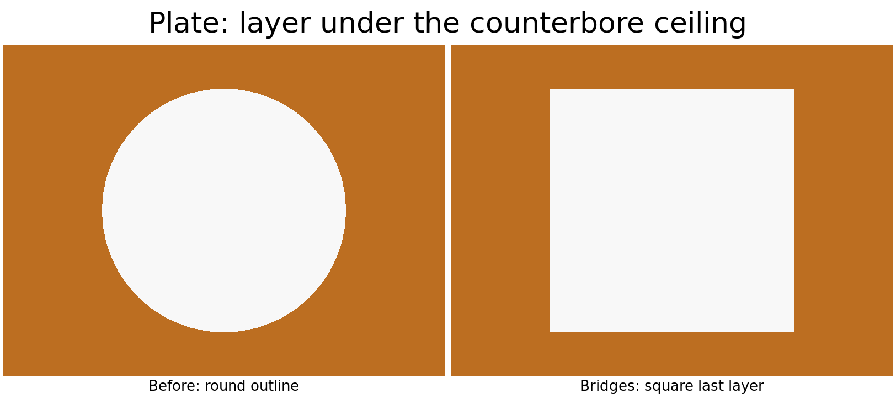

The fix also changes blind holes that go up, for example a screw hole from below in a part that stands upright. The flat round end of such a hole is a small bridge. The fix makes a 45 degree cone at the end. A slope of 45 degrees prints without support. On the desk dock, the stand lies on its side, so its blind holes are horizontal and get a teardrop.

**When to use it.** Use it for holes and pockets on the bed side, for counterbores of screw heads and nuts, and for blind holes that go up. Select **Sacrificial** for a strong, closed bridge when you can drill the hole. Select **Stepped** when you do not want to drill. A bridge that is longer than the bridge limit (12 mm by default) does not change. The **Check** card lists it.

### Teardrop holes

The top of a round hole with a horizontal axis is a ceiling in the air. It sags, or it needs support.

**What the fix does.** The top of the hole gets a 45 degree point, as a teardrop. The bottom and the sides of the hole stay round. On the stand, the cable hole and the two pilot holes get the point. The fix shows "4 holes".

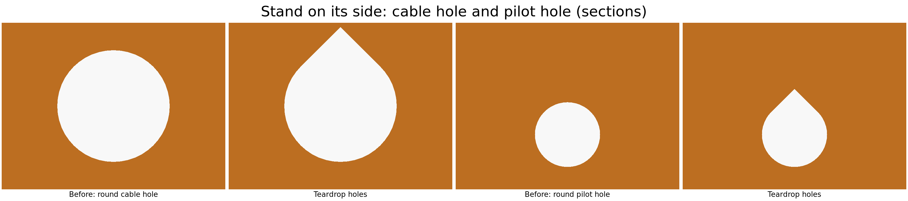

**When to use it.** Use it for horizontal holes for cables, screws and pins, from 1 to 40 mm in diameter. The point makes the hole higher at the top. A shaft in the hole then touches only the bottom and the sides of the hole. When the wall above a hole is too thin for the point, CoCAD does not change the hole. The card then shows "1 place skipped" with the reason "wall above too thin".

### Brim on small islands

A thin line of the first layer has little contact with the bed. It can come loose during the print.

**What the fix does.** CoCAD finds the small areas of the first layer: areas that are thinner than 3 mm or smaller than 25 mm². Each small area gets a brim of one layer around it, 5 mm wide by default. The brim keeps a gap of 1 mm from the rest of the part. The brim stays inside the print area.

On the desk dock with Auto orientation, no part has a small island: the fix shows "0 brims". When you turn off **Custom orientation** for the stand, the stand stands as on the desk, on its front foot. The foot is 2.4 mm thin. It then gets a brim.

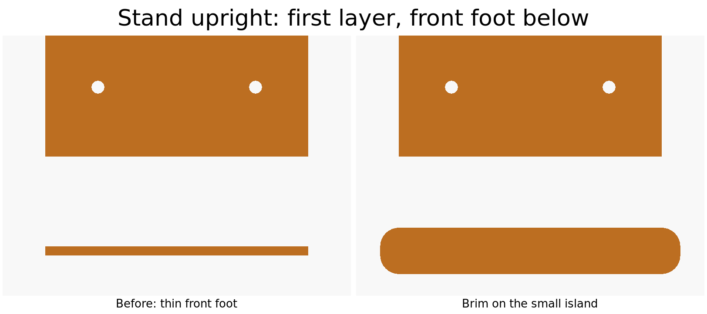

**When to use it.** Use it for thin feet, thin walls on the bed and small pins that stand on the bed. After the print, cut the brim off the part. The brim is only one layer thick.

### Bed chamfer

The first layers of a print spread out a little, because the nozzle presses them onto the bed. This is the **elephant foot**. The part then is a little wider at the bed than above it. Parts that go together can then be too tight, and the bottom edge is not clean.

**What the fix does.** The edges on the bed get a 45 degree chamfer. The chamfer is a staircase of whole layers. With layers of 0.2 mm, a chamfer of 0.4 mm has two steps. The edge of the first layer is 0.4 mm in from the side of the part. The edge of the second layer is 0.2 mm in.

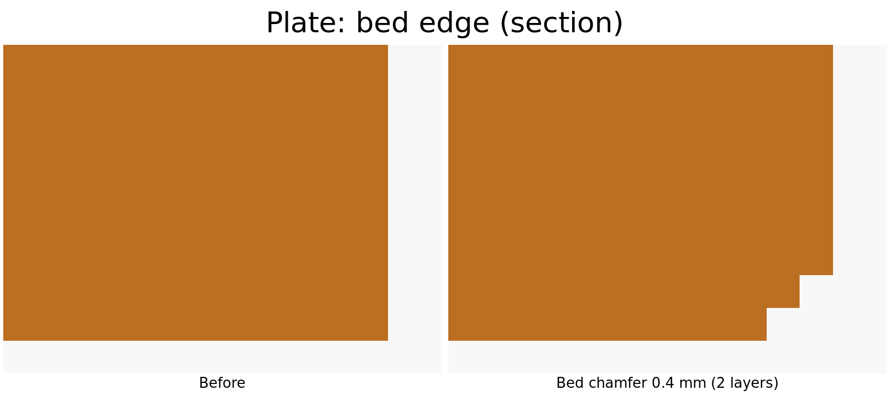

Why a staircase, and not a smooth slope? The slicer prints whole layers, and each layer has one outline. With a smooth slope in the model, the slicer takes the outline of each layer from one height in the slope. The first layer then is smaller by less than the full chamfer. With steps of whole layers, the outline of each layer is exact: each printed layer gets the full chamfer for its height. CoCAD uses the layer heights of the **Print settings** card, and rounds the size to whole layers.

Other properties of the bed chamfer:

- An edge that has a chamfer or a foot in the model does not get a second chamfer.
- Holes and pockets on the bed get the same chamfer: they are a little larger at the bed.
- A wall that is too thin for the chamfer keeps its first layers at full size.
- The brim comes after the chamfer, so the chamfer does not cut the brim.

**When to use it.** Use it on all parts that stand on a flat face, and always for parts that must fit together. Then set the elephant foot compensation of your slicer to 0. Without this, the bed edges get two corrections. In PrusaSlicer and OrcaSlicer, the setting is "Elephant foot compensation". In Cura, it is "Initial Layer Horizontal Expansion".

### All fixes together

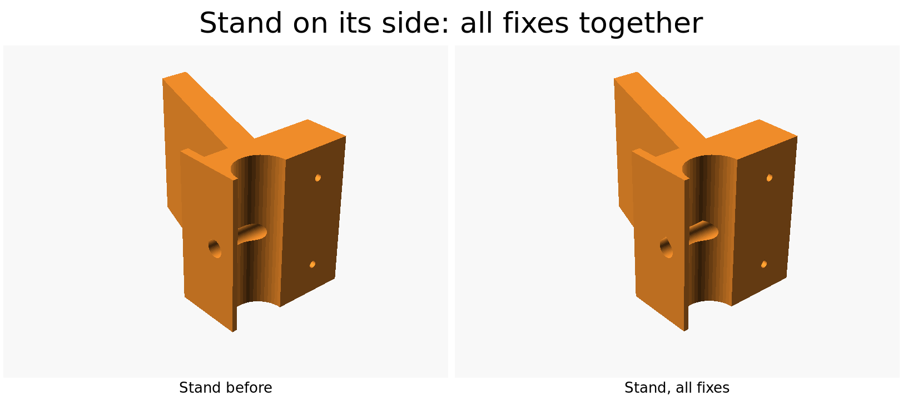

The fixes work together. CoCAD applies them in this order: the cuts and the additions of the teardrops and the bridges, then the bed chamfer, then the brim.

## 5. Check the orientation

The model shows the dock as it stands on the desk. That is not always a good position for the print. By default, **Custom orientation** is on with **Auto**: CoCAD puts each part on its best face. It prefers less overhang, more area on the bed and a lower part.

- **The clips** sit tilted on the back of the stand. In this rotation, a clip stands on an edge on the bed, and the **Check** card lists 5 problems for it. Auto puts the clip on its flat face. The cable hole then goes up, so it needs no teardrop, and the clip has no problems.
- **The stand** lies on its side. Its outline is on the bed, so the back support needs no support material.

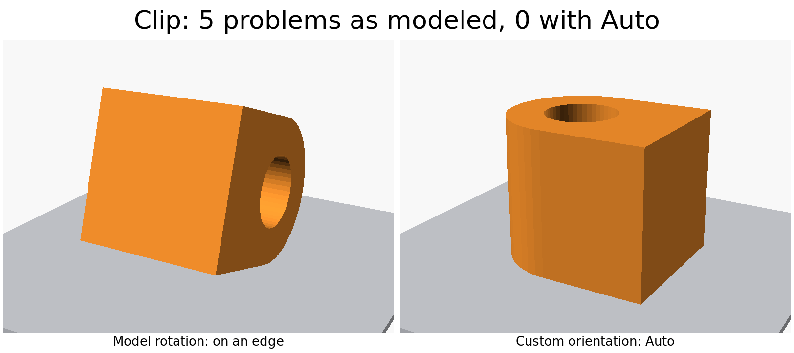

To change the orientation of a part:

1. Click the part in the **Plate** card, or in the 3D view.
2. In the **Orientation** card, click **Select face**, then click a face of the part in the 3D view. That face goes on the bed. **Turn 90°** turns the part on the bed.
3. To keep the rotation of the model, turn off **Custom orientation**.

The orientation applies to all copies of the part. Only you know which face must look good, and in which direction the part must be strong.

## 6. Split the base plate

The base plate is 260 mm long. It does not fit the print area of 220 × 220 mm. The **Split** section below its row shows the proposal:

- **Dovetail**: CoCAD proposes a dovetail for a flat part. The tabs are in the plane of the plate, so they print flat on the bed.
- **Clearance**: 0.20 mm, the total gap of the joint.
- **Cut 1 at x**: 130.0 mm, the middle of the plate.
- The two pieces: 135.0 × 80.0 × 6.0 mm and 130.0 × 80.0 × 6.0 mm. Both fit.

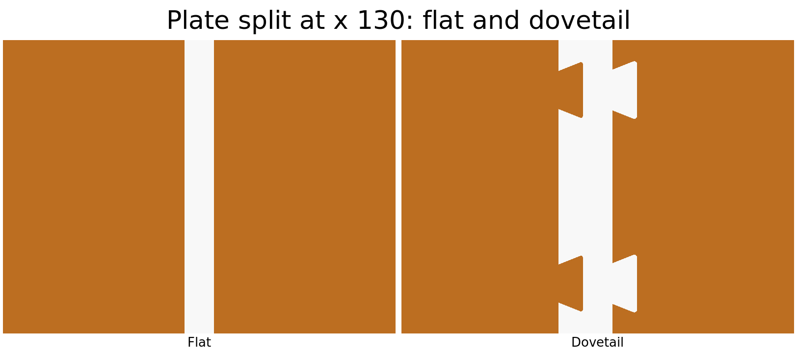

Click **Split**. The plate becomes two print parts:

- **Part 1 1/2**, 134.9 × 80.0 × 6.0 mm, with the tabs.
- **Part 1 2/2**, 129.9 × 80.0 × 6.0 mm, with the sockets.

All parts are now on one plate.

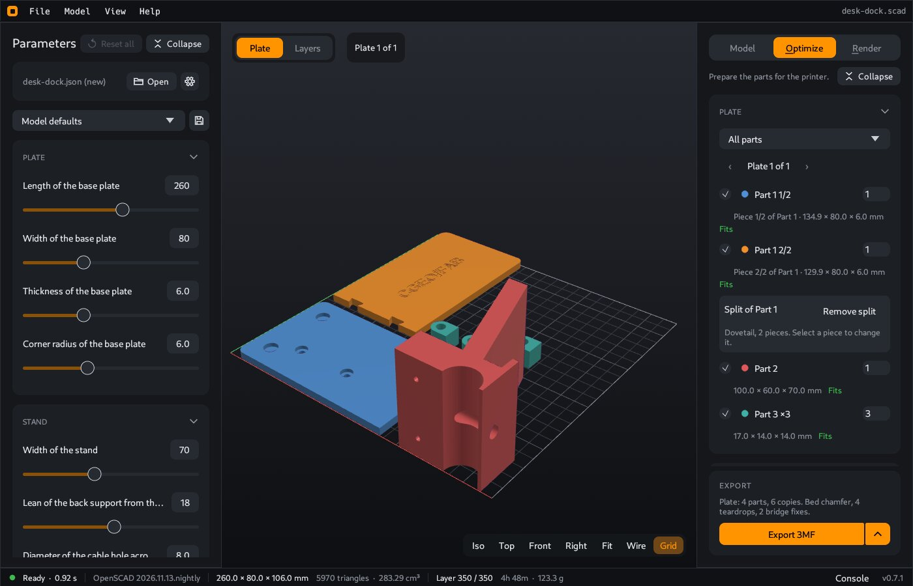

Click **Top** at the bottom of the 3D view to see the plate from above:

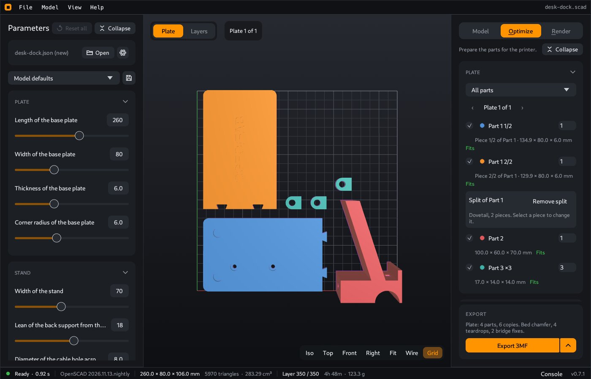

Each piece gets its own Auto orientation. **Part 1 2/2** lies with the wordmark up. **Part 1 1/2** lies upside down: its two screw counterbores and two magnet pockets open to the top, so they need no bridge. To print both pieces with the wordmark up, select **Part 1 1/2** and turn off **Custom orientation**.

The print fixes also apply to the pieces. The **Bridges** fix changes the two magnet pockets of **Part 1 2/2**: "2 fixed". The line of the **Export** card is now "Bed chamfer, 4 teardrops, 2 bridge fixes".

To change the split, select a piece. **Remove split** makes the plate whole again.

## 7. More than one plate

A printer with a smaller print area needs more plates. For example, with the **Prusa MINI+** (180 × 180 × 180 mm), the parts need two plates. Plate 1 holds the two pieces of the plate and two clips. Plate 2 holds the stand and one clip.

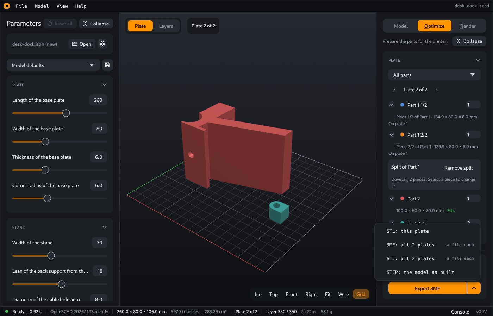

Use the arrows in the **Plate** card to see the other plate. Click the arrow at the right of **Export 3MF** in the **Export** card. The menu has **3MF: all 2 plates** and **STL: all 2 plates**, which write one file for each plate.

## 8. Look at the layers

Click **Layers** at the top left of the 3D view. The view shows the print layers of the plate, with the fixes. Move the slider at the right edge of the view, or press Up and Down, to go through the layers.

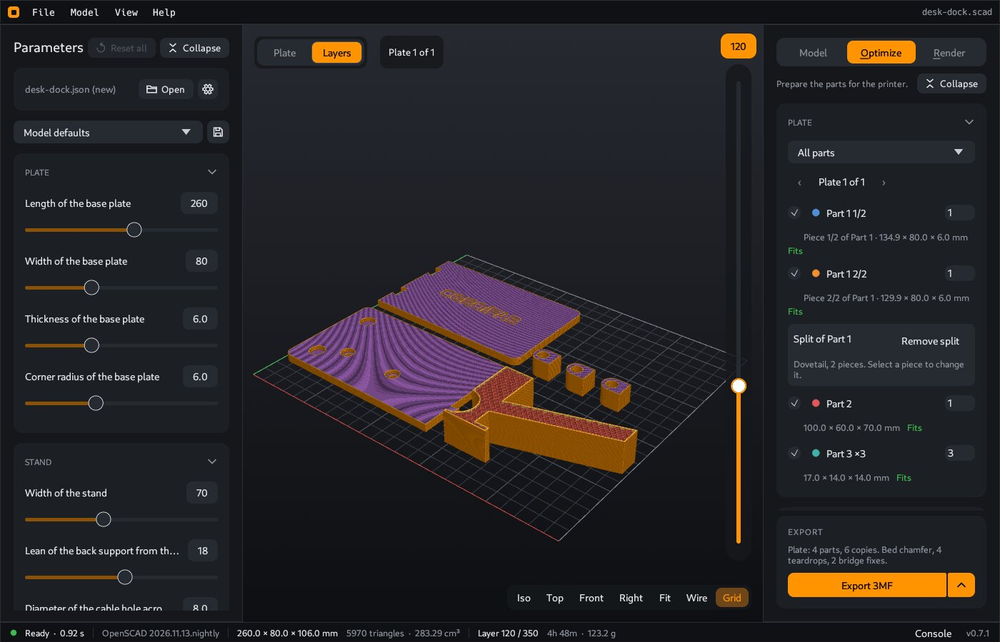

The **Layers** card shows a rough estimate of the print time, the weight and the filament for the current plate.

## 9. Export the plate

In the **Export** card at the bottom of the tab, click **Export 3MF**. For an STL file, click the arrow at the right of **Export 3MF**, then **STL: this plate**.

- The 3MF file has one object for each print part, and one item for each copy. Your slicer shows the parts as separate objects, in the positions of the plate.
- With two or more plates, **3MF: all 2 plates** in the same menu writes one file for each plate, for example `desk-dock-plate1.3mf` and `desk-dock-plate2.3mf`.

In your slicer, set the elephant foot compensation to 0, because the bed chamfer is on.

CoCAD stores all values of this guide with the model: the print area, the fixes, the orientation of each part and the split. When you open the model again, they are the same. The [command line](Command-line) uses them too.

## 10. After the print

- If you printed **Part 1 1/2** with the wordmark up, drill its screw holes open through the sacrificial layers. With **Stepped**, you do not have to do this.
- Glue the two pieces of the base plate together at the dovetail.
- Put the magnets in their pockets, and attach the stand with the screws.
