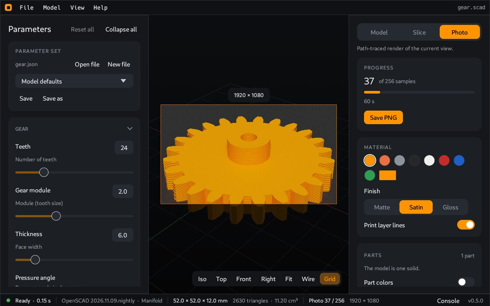

# Render

The **Render** tab makes a picture of the part that looks like a studio photo, with soft light and shadows. You can use it for a shop page, a README or a message to a friend.

## Make a photo

1. Click the **Render** tab on the right, or press `R`. Press `R` again to go back to the **Model** tab.
2. Turn and move the view until you like it. The view dims the area outside the image frame, so you see what the photo will show.
3. Click **Render** at the bottom of the tab. The render starts when the view rests. The image gets cleaner with time.
4. Click **Save PNG** below **Render**. The dialog opens in the folder of your last export.

The tab does not start a render when you open it. When you move the view or change a setting, the render stops and the frame shows the 3D view again. Click **Render** again for a new render.

While the render runs, **Render** changes to **Stop**. You can save at any time. **Save PNG** writes the image at its full size, with the quality that it has at that moment. After **Stop**, you can still save the samples that are done.

The bar at the bottom of the tab shows:

- The number of samples that are done and the number of samples that you set. At the right: "Waiting for the view to rest" before the render starts, the time of the render while it runs, "Done in" and the time at the end, or "Stopped".
- A bar that shows the progress.
- **Render** (or **Stop**) and **Save PNG**. Before you build the model, **Render** is not available.

The size of the image is in the header of the **Quality** card when the card is closed.

## Settings

### Material

- **Color**: a model with two or more parts has two choices.
  - **One color**: all parts have the same color. Click one of the 8 color swatches, or click the color button for your own color.
  - **Each part**: each part has its own color. This is the [Part colors](Parts#part-colors) switch of the **Model** tab. A list shows each part with its color. Click a row, or click a part in the view, to select that part. The swatches then set the color of the selected part. With no part selected, the swatches set the color of all parts. **Reset** gives a part its default color again. **Reset all** does this for all parts.
  - A model that is one solid has the swatches only.
- **Finish**: **Matte**, **Satin** or **Gloss** plastic. The finish is the same for all parts.
- **Print layer lines**: adds fine lines on the sides, so that the part looks 3D printed.

### Scene

- **Studio**: a **Dark** or a **Light** background.
- **Exposure**: the brightness of the image.

### Quality

- **Samples**: 16 to 2048. More samples give a cleaner image and take more time.
- **Resolution**: the size of the image in pixels. The presets are 720p, 1080p, 1440p, 4K, site preview 4:3 (1600 × 1200), square, portrait 4:5 and story 9:16. You can also type the width and the height.
- **Swap** changes between landscape and portrait.

The other cards of the tab can close and open, as in the other tabs.

## Parts in the photo

The photo shows the model as built, with the [part colors](Parts#part-colors), the [explode](Parts#explode) and the [section](Parts#section) of the 3D view. It does not show the selection, the focus or the [reference parts](Parts#reference-parts).

The photo shows the model, not the print plate of the [Optimize](Optimize) tab.

---

**For technical readers.** The render is a path tracer. It runs on the GPU when the graphics driver has OpenGL 3.3 and is not a software renderer. If not, it uses all CPU cores. The status bar shows `GPU` or `CPU` after the sample count. If the GPU stops during a render, the render continues on the CPU. To select one, set the environment variable `COCAD_RENDER` to `gpu` or `cpu` before you start CoCAD. One sample is one pass over all pixels of the image. `cocad photo` makes a photo in a terminal. It always uses the CPU. See [Command line](Command-line).
