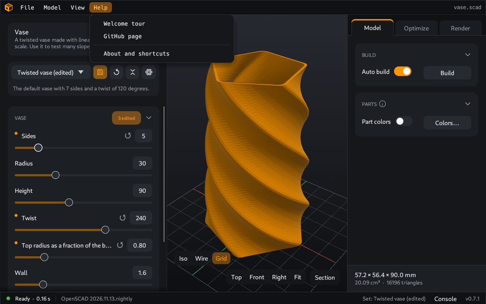

# Settings

Open the settings with **File > Settings** or Ctrl+, (Ctrl and the comma key).

The window has one page for each topic. Change what you want, then click **Save**. **Cancel** or Esc closes the window without a change.

## Appearance

**Theme**: **Light**, **Dark** or **System**. **System** follows the theme of your computer.

## Parameter sets

**Auto save**: saves your values to the selected set when you change them. It is off by default. With **Model defaults** selected, nothing is saved. See [Parameter sets](Parameter-sets#auto-save).

## OpenSCAD

This page shows if CoCAD found OpenSCAD, and its version.

- **Binary**: the OpenSCAD program. Leave it empty and CoCAD finds the program itself. Click **Browse** to select a program, for example a development snapshot that you downloaded.
- **Extra arguments**: options that CoCAD gives to OpenSCAD. Most users leave this empty.
- **Manifold backend**: uses the fast method of OpenSCAD to calculate the shape. It needs an OpenSCAD development build. The switch is not available when your OpenSCAD does not have this method.

If the page shows "Not found. Set the binary.", see [Install](Install#if-cocad-does-not-find-openscad).

## MCP server

**Allow MCP clients**: lets programs on this computer, such as Claude Desktop, control this window. It is on by default. See [AI assistant](AI-assistant).

The page also shows the state of the server: **Running** or **Off**.

## Updates

**Check for new versions**: when the window opens and once a day after that, CoCAD asks GitHub for the list of releases.

- If a newer version exists, a small notice shows at the bottom right of the window.
- Click the notice to see the changes. The button in that window opens the download section of the website.
- Click × to hide the notice until a newer version comes.
- CoCAD does not download or install anything.

For this check, GitHub sees your IP address and the app version. Turn off **Check for new versions** to stop the check.

## Privacy

Two switches: **Usage analytics** and **Error reports**. Both are optional. A change applies at once. The page also shows your install ID, with **Copy** and **Reset**. See [Privacy](Privacy).

This page shows only in a build that can send data. See the note on the [Privacy](Privacy) page.

---

**For technical readers.** The environment variables `$OPENSCAD` and `$OPENSCAD_ARGS` override the saved values. For the Manifold backend and the place of the settings file, see [OpenSCAD engine and files](OpenSCAD-engine-and-files).
